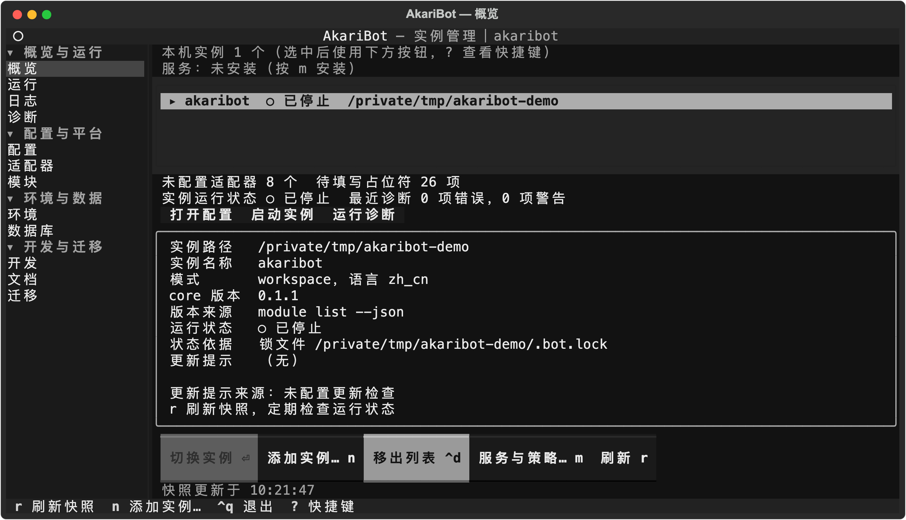
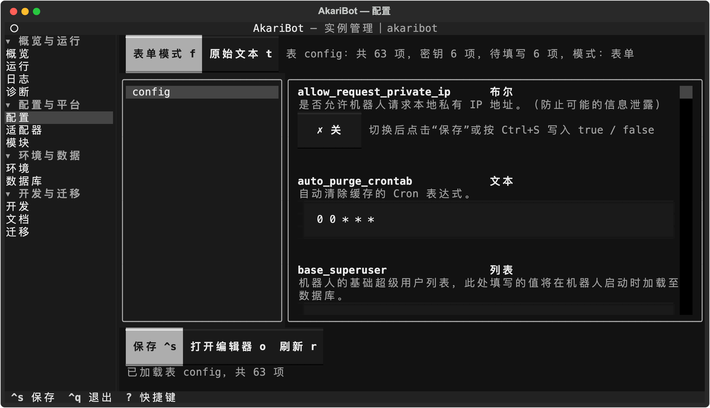
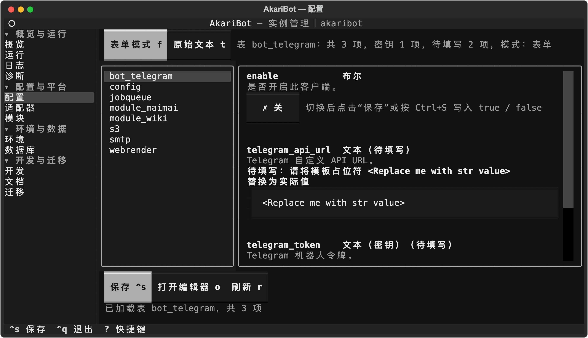
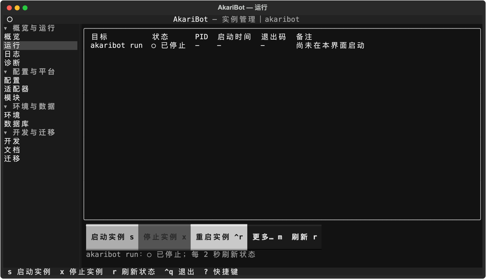
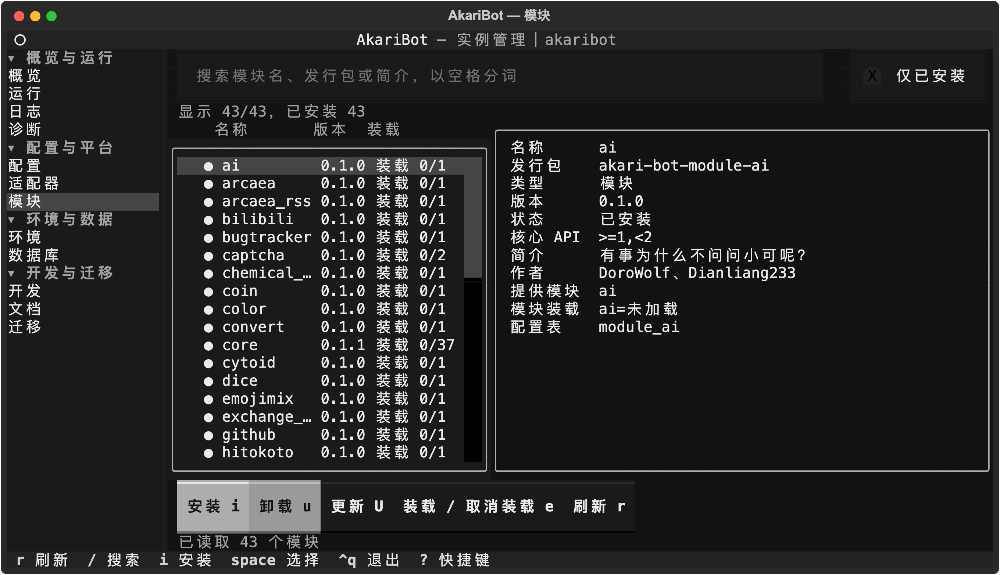
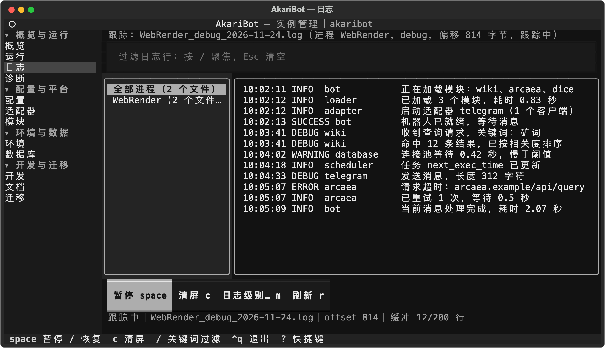

# 自搭建指南

搭建自己的机器人，需要一台能运行 Python 的计算机，以及一个准备接入的平台账号。

本页以终端界面（TUI）为主。安装 CLI 后，创建实例、填写配置、安装适配器、启动与停止以及查看日志均在界面中完成。命令行用于安装，也覆盖自动化与服务器场景。

## 先认识几个部分

- **命令行工具（CLI）**：`akaribot` 命令与 TUI。CLI 独立安装在实例环境之外，负责创建、启动与检查实例。
- **实例**：一个独立目录，保存配置、数据库、日志、缓存与实例自己的 Python 环境。
- **core**：机器人的运行时。
- **适配器**：连接具体平台，例如 Telegram、QQ、Discord 或 Web。
- **模块**：提供命令与功能，例如查询、订阅、小游戏。

CLI 通过 core 的子进程入口读写实例。每个实例可以单独升级，CLI 的环境依赖与实例隔离。

## 准备环境

安装前需要准备：

- Python 3.12 或更高版本。
- [uv](https://docs.astral.sh/uv/)，用于创建实例环境并安装包。
- Node.js 与 `npm`，仅在本地构建文档站点时需要。版本要求由主题的 `docs-theme.json` 声明。

默认数据库为 SQLite，连接字符串为 `sqlite://database/save.db`。需要使用 MySQL 时，将密钥表中的 `db_path` 替换为 MySQL 连接字符串。core 默认安装的依赖已包含 MySQL 驱动。

## 安装 CLI

将 CLI 安装为独立工具，不要安装至实例环境：

```sh
uv tool install akari-bot-cli
akaribot --version
```

安装后，创建实例与日常操作均在 TUI 中完成。

从仓库源码使用时，在仓库根目录执行：

```sh
uv sync --all-extras --dev
.venv/bin/akaribot --version
```

后续命令中的 `akaribot` 替换为 `.venv/bin/akaribot` 即可。

## 打开 TUI

```sh
akaribot
```

不带子命令运行且终端支持交互时，进入界面。也可以显式执行 `akaribot tui`。

首次运行时，若本机还没有实例，CLI 会先询问是否在当前目录初始化实例。确认后创建实例并进入界面。

界面打开后进入概览页，右侧列出实例清单与当前实例的状态摘要。



实例清单列出本机实例，选中后按 `Enter` 切换当前实例。

### 新建实例

在概览页按 `n`，选择“新建实例”，随后依次确认：

| 字段 | 说明 |
| --- | --- |
| 实例目录 | 实例保存位置，例如 `/srv/akaribot`。目录不存在时由界面创建。 |
| 运行环境 | 默认“创建托管 venv”，由实例自己管理 Python 环境；已经准备过环境时选择“使用当前环境”。 |

实例语言跟随当前界面语言。确认后，界面调用 `akaribot init` 创建目录、建立虚拟环境、安装 core 与默认适配器，并执行数据库迁移。此过程可能耗时数分钟。完成后，概览页列出该实例。

系统默认安装 Telegram 适配器。若需要在创建时安装其他适配器，参见文末“高阶命令行用法”一节。

## 填写核心配置

进入“配置”页，左侧列出实例中的配置表。选中 `config` 表，右侧显示该表的表单字段。



表单中通常需要优先填写以下项：

- `base_superuser`：你的发送者 ID。默认值来自上游维护者，自建实例需要替换为自己的账号，或留空。
- `db_path`：默认值指向 SQLite，通常无需修改。
- `proxy`、`ffmpeg_path`：没有对应环境时留空。

配置项分为普通项与密钥项，密钥项以密码框填写。页面上方标注该表密钥项与待填写项的数量。按 `Enter` 键进入下一项，按 `Ctrl+S` 保存。字段仍保留占位符时，输入框上方会显示待填写提示。填入实际值后，提示消失。

按 `f` 切换到表单模式，按 `t` 切换到原始文本模式，按 `o` 使用外部编辑器打开该表。保存后若提示重新加载，按页面提示操作。

## 创建适配器实例

默认安装的 Telegram 适配器还没有实例。进入“适配器”页，按以下步骤创建：

1. 按 `n` 新建实例。
2. 选择 Telegram。
3. 填写实例 ID，例如 `main`。实例 ID 用于关联数据，创建后不可更改。
4. 在配置表单中填写 Bot Token。
5. 将 `enable` 设为 `true`。
6. 按 `Ctrl+S` 保存。

创建后会弹出该实例的配置表单，待填项排在前面，`enable` 排在最后。Telegram 适配器的配置表包含 `enable`、`telegram_api_url` 与 `telegram_token` 三项，Bot Token 记录在 `telegram_token`。



实例 ID 仅可使用小写字母、数字与下划线，长度为 1 到 24 个字符。实例配置保存在 `config/bot_telegram-main.toml` 这样的文件中。

需要使用 Web、Discord、QQ 等其他平台时，按以下步骤操作：

1. 在“适配器”页按 `i`，从尚未安装的平台中选择。
2. 安装完成后按 `n`，创建实例、填写配置并启用。

平台账号、Token 与回调地址的申请方式参见各适配器的文档，入口在“适配器”页或左侧文档分类中。

## 启动机器人

进入“运行”页，按 `s` 启动当前实例。界面先弹出确认框，确认后在后台启动进程，状态每 2 秒自动刷新。



启动后，在群聊或私聊中向机器人发送一条命令，例如：

```text
~help
```

若收到回复，表明适配器与机器人已正常连通。

停止运行按 `x`，重启按 `Ctrl+R`。退出 TUI 后，机器人仍在后台运行。

## 安装模块

进入“模块”页，按 `i` 安装所需模块，选择目标后确认。安装仅将代码写入实例。



模块需要在实例中全局加载后，才参与命令匹配。选中模块后按 `e` 切换加载状态。

特定群聊或频道是否能够使用该模块，还需单独开启。在聊天中执行：

```text
~module enable <模块名>
```

## 设置常驻服务

确认机器人能正常启动后，回到“概览”页，按 `m` 打开服务与策略菜单：

- 开启开机自启，使服务启动时恢复实例。
- 开启崩溃后自动重启。
- 安装系统服务，将实例交由服务托管。

Windows 不支持安装系统服务。需要开机启动时，使用任务计划程序或容器编排工具代替系统服务。

服务启动时仅恢复已开启开机自启的实例。

## 更新与备份

### 更新

在“模块”页按 `r` 刷新，再按 `U` 选择更新选中项或全部已安装的包。全部更新包含 core、适配器与模块。更新后界面会尝试自动重新加载。若改动需要重启才生效，前往“运行”页按 `Ctrl+R`。

更新前先备份配置、数据与数据库。更新失败时先查看“日志”页的异常，再判断是否回退。

### 备份

需要备份的内容：

| 路径 | 内容 |
| --- | --- |
| `akaribot.toml` | 实例元数据。 |
| `config/` | 配置表与密钥。 |
| `data/` | 模块数据与实例私有数据。 |
| `database/` | SQLite 数据库。 |
| `assets/private/` | 实例私有资源。 |

`cache/`、`logs/` 与 `.venv/` 无需备份。恢复时将上述目录移回实例根目录，再启动实例。

## 排查问题

- 在“诊断”页检查端口冲突、登录信息重复与孤立配置。
- 在“日志”页按 `m` 选择日志级别，按 `/` 过滤关键词。使用左侧列表切换日志文件。
- 在“配置”页确认适配器的 `enable` 已开启，Token 未包含多余空格。
- 在“运行”页确认进程状态，必要时停止后重新启动。



若启动时提示配置表不存在，先在“适配器”或“模块”页重新安装对应成员包，通过安装流程补充配置。随后核对配置目录。

## TUI 常用键位

| 键 | 作用 |
| --- | --- |
| `q` / `Ctrl+Q` | 退出界面。 |
| `?` | 查看当前页与全局键位。 |
| `Ctrl+←` / `Ctrl+→` | 上一页 / 下一页。 |
| `↑` / `↓` / `Enter` | 选择并打开。 |
| `←` / `→` | 收起 / 展开侧边栏分组。 |
| `r` | 刷新当前页。 |
| `Ctrl+S` | 保存当前编辑内容。 |
| `Esc` | 返回或取消当前操作。 |

各页的完整键位参见 [终端界面](tui.md)。

## 高阶命令行用法

TUI 覆盖日常操作。下列命令适用于自动化、批量部署与无界面服务器场景。

创建实例时指定适配器或模块：

```sh
akaribot init /srv/akaribot --adapter telegram --adapter web
akaribot init /srv/akaribot --module wiki
```

后台运行与服务：

```sh
akaribot run -d
akaribot service install
akaribot service status
```

配置与模块：

```sh
akaribot config list
akaribot config schema --table config
akaribot module add wiki
akaribot module update --all
```

实例与诊断：

```sh
akaribot instance list
akaribot doctor
akaribot logs --follow
```

在容器中运行时，将实例目录挂载到容器内，使用 CLI 启动。容器中没有可用的 TUI。具体参数参见 [命令参考](commands.md)。

## 相关文档

- [命令参考](commands.md)：所有子命令与选项。
- [配置](../../../../akari-bot-core/akaribot/core/docs/config.md)：配置表、密钥与默认层。
- [适配器开发](../../../../akari-bot-core/akaribot/core/docs/adapter-development.md)：写一个新的平台适配器。
- [模块开发](../../../../akari-bot-core/akaribot/core/docs/module-development.md)：从第一个模块开始。
- [常见问题](../../../../akari-bot-core/akaribot/core/docs/faq.md)：启动、权限和平台相关的常见问题。
