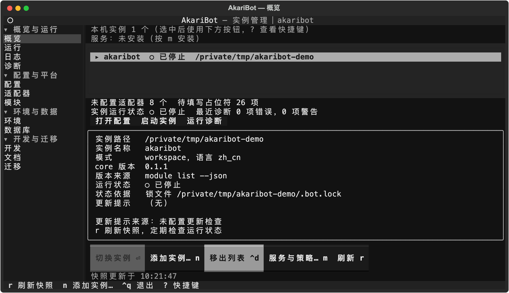
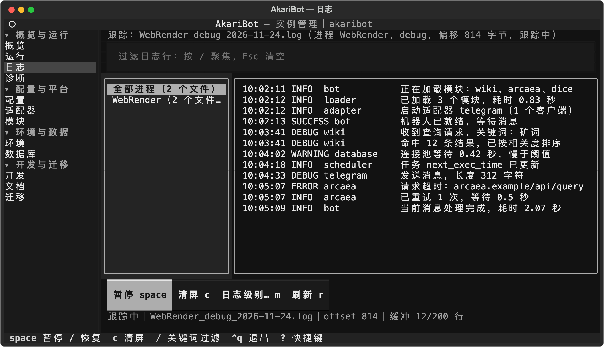
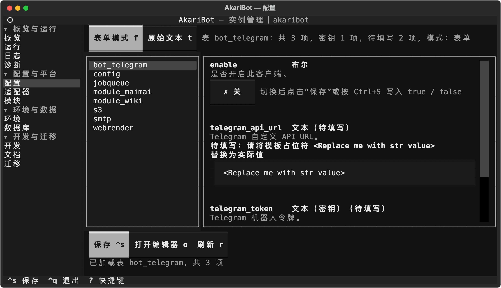
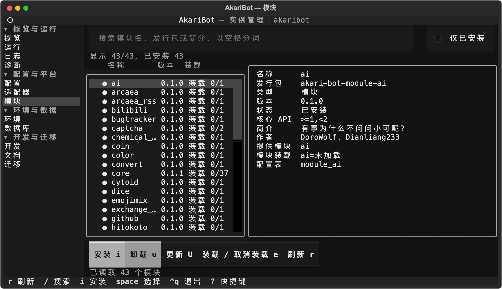
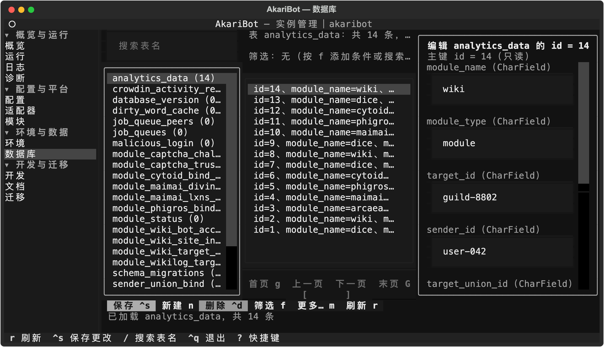

# 终端界面

终端界面（TUI）用 Textual 实现，无须记忆子命令与选项。

界面负责实例的日常运维：

- 启动与停止
- 模块安装
- 配置编辑
- 数据库浏览
- 日志跟踪
- 环境管理
- 文档浏览与发布
- 旧项目迁移

所有写入操作均由 CLI 子进程完成，参数与确认仅在命令层实现。对应命令参见 [命令参考](commands.md)。

侧边栏为按用途分组的页面列表，右侧为当前页面。标题栏显示当前实例的名称，页脚列出当前页面的高频快捷键。



## 启动

```sh
akaribot            # 可交互终端下直接进界面
akaribot tui
akaribot tui --no-mouse
```

不带子命令运行 `akaribot` 时，仅在可交互终端下才会进入界面。管道、重定向与 CI 环境下输出帮助信息，并以退出码 2 终止。无可用实例时先询问是否就地初始化，初始化通过 `akaribot init` 命令完成。

启动时将当前实例写入注册表。若当前目录不属于任何实例，且目录下仅有一个实例，则直接选用并切换到该实例。当前目录下存在多个实例时仅提示，不自动选择。标题栏显示当前管理的实例名称。

`--self-check` 在无终端环境下检查资源、样式表与页面交互。`--headless` 启动界面，完成基础读取后退出。两者均用于部署后的基本功能检查，未执行的检查按失败处理。两者仅读取实例信息，不修改注册表。

## 页面

侧边栏页面分为四组。`Ctrl+←` / `Ctrl+→` 按同一顺序翻页，折叠分组内的页面同样可达：

| 分组 | 页面 | 用途 |
| --- | --- | --- |
| 概览与运行 | 概览 | 实例与服务状态、实例清单、初始化摘要 |
| | 运行 | 前台/后台启动与停止、按适配器启动、状态轮询 |
| | 日志 | 日志文件筛选、暂停与增量跟踪 |
| | 诊断 | 端口冲突、重复的登录信息、没有对应适配器的配置 |
| 配置与平台 | 配置 | 配置表的表单与原始文本两种模式 |
| | 适配器 | 适配器实例的启动与停止、安装、添加与删除 |
| | 模块 | 模块安装、卸载、更新与全局加载 |
| 环境与数据 | 环境 | 解释器、已安装包与运行库清单 |
| | 数据库 | 表清单、分页浏览与按主键编辑 |
| 开发与迁移 | 开发 | 工作区包清单、运行测试、生成脚手架 |
| | 文档 | 已安装包的文档浏览、构建、开发预览、预览与部署 |
| | 迁移 | 旧项目迁移与试运行 |

切换页面时焦点移交至目标页面，隐藏页面停止轮询。页面未激活前不读取数据。

## 全局键位

| 键 | 动作 |
| --- | --- |
| `q` / `Ctrl+Q` | 退出 |
| `?` | 当前页与全局键位帮助 |
| `Ctrl+T` | 深色/浅色主题切换 |
| `Ctrl+←` / `Ctrl+→` | 上一页 / 下一页 |
| `↑` / `↓` / `Enter` | 选择页面并打开。在分组标题上按 `Enter` 或单击切换折叠 |
| `←` / `→` | 折叠所在分组 / 展开高亮的分组 |

折叠分组内的页面不显示，方向键跳过。当前页位于折叠分组内时，侧边栏高亮该分组标题。折叠状态仅在本次运行期间保留。

页脚仅展示高频快捷键，低频操作收纳于 `?` 帮助与页内按钮中，在 80 列终端下不产生溢出。

## 页面键位

- 概览：`r` 刷新，`Enter` 切换实例，`n` 添加实例（新建或选择目录），`Ctrl+D` 从注册表移除，`m` 服务与策略（开机自启、崩溃重启、安装或卸载服务）。
- 运行：`s` 启动，`x` 停止，`Ctrl+R` 重启，`r` 刷新，`m` 更多（按适配器启动、前台运行命令）。
- 日志：`space` 暂停跟踪，`c` 清空显示缓冲，`/` 过滤，`m` 日志级别，`r` 刷新，`Esc` 清空过滤。
- 诊断：`r` 刷新，`Enter` 打开冲突详情。
- 配置：`Ctrl+S` 保存，`o` 外部编辑器，`f` 表单模式，`t` 原始文本，`r` 刷新，`Esc` 返回表清单。
- 适配器：`r` 刷新，`i` 安装适配器，`e` 启用/停用实例，`n` 新增实例，`Ctrl+D` 移除实例。
  - 列表仅显示已安装或已启用的适配器。未安装的平台，需要先按 `i` 打开安装对话框选择。
  - 新增实例时，在对话框中选择已安装的适配器并填写实例 ID。`↑` / `↓` 切换平台，`Enter` 创建。
  - `Ctrl+D` 移除实例并提示是否清理该适配器的配置。
- 模块：`r` 刷新，`i` 安装模块，`u` 卸载模块，`U` 打开更新对话框（可选当前选区或全部已安装模块），`e` 切换全局加载。按空格多选，`Ctrl+点击` 切换。
- 环境：`r` 刷新，`i` 安装包，`u` 卸载包，`m` 解释器菜单。
  - 接管、取消接管、重建 venv，仅列出当前模式可用的项。
  - 卸载包时显示反向依赖，并提示是否从实例清单中删除。
- 数据库：`r` 刷新，`Ctrl+S` 保存，`n` 新建记录，`Ctrl+D` 删除记录，`f` 筛选，`m` 排序，`[` / `]` 翻页。
- 开发：`r` 刷新，`t` 运行测试，`n` 新建包。
- 文档：`r` 刷新，`b` 构建站点，`p` 静态预览，`e` 开发预览，`o` 打开浏览器，`m` 部署与同步。
- 迁移：`r` 刷新，`p` 试运行，`Enter` 执行迁移。选择旧项目目录后，界面调用 `akaribot migrate legacy`。

各页按钮文字后附快捷键（如“保存 ^s”），写法与页脚保持一致。低频操作收纳于 `m` 菜单中，菜单仅列出当前可用的项。

## 页面操作

### 概览

概览页显示本机实例清单、当前实例的启动准备状态与服务策略。实例清单来自注册表，运行状态来自锁文件。

- 每行显示注册名、运行状态、位置和启动策略。当前实例用 `▸` 标出。当前实例未写入注册表时也会出现在列表里。未写入注册表的实例仅在当前会话使用。
- `Enter` 切换到高亮实例。`n` 打开新建或添加对话框。`Ctrl+D` 从注册表移除（不删除文件）。
- `m` 打开服务与策略菜单（包含开机自启、崩溃重启、安装系统服务）。
- 实例清单按名称排序。按 `/` 过滤实例。

### 运行与日志

运行页的启动、停止、重启都先确认。启动指定适配器、前台运行等低频操作放在 `m` 菜单。

状态查询在后台执行，同类请求仅保留最新一次。实例进程独立于界面运行。退出界面后实例继续运行。

日志页按实例 `logs/` 下的最新文件跟踪：

- `space` 暂停或恢复跟踪，`c` 清空当前显示缓冲。
- `/` 输入关键词过滤，`Esc` 清空过滤。
- `m` 选择自动跟随、INFO 文件或 debug 文件。
- 日志解析规则由 `akaribot logs` 提供，界面直接复用。



### 配置、适配器与模块

配置页提供表单、原始文本与外部编辑器三种编辑模式。表单按 `config schema` 生成，仅列出当前表声明的字段。保存前会标记未写入的占位符。切换表、切换模式或离开页面时，若有未保存更改会弹出确认框。



适配器页：

- 列表仅显示已安装或已启用的平台。未安装的平台先按 `i` 选择安装。
- `n` 新建实例。对话框仅列出已安装平台，实例名称格式为 `bot_<平台>-<名称>`。
- `e` 切换启用状态。停用后不随机器人启动，配置保留。
- `Ctrl+D` 仅删除实例配置，保留场景启用与全局加载。

模块页：

- 支持单选与多选。方向键移动，`Space` 切换选择，`a` 全选，`Ctrl+点击` 切换。
- `i` 安装、`u` 卸载、`U` 更新，`e` 切换全局加载。安装和卸载前会列出目标。
- 批量卸载时逐项执行，单项失败不终止其余项。结束后汇总成功与失败。清理数据的卸载要求输入确认文字或目标数量。
- 安装、加载与场景启用为三项独立操作。安装将代码写入实例环境，加载使模块参与命令匹配，场景启用控制特定群聊或频道能否使用。



### 环境与数据库

环境页管理实例解释器和运行库：

- `i` 安装 PyPI 包、版本范围、仓库地址或 `git+` 引用，可选择是否写入实例清单。
- `u` 卸载并选择是否保留清单记录。选中包会显示反向依赖。
- `m` 打开解释器菜单（包含接管 venv、取消接管、重建 venv）。重建前要求输入“重建”，未写入清单的额外包不会自动恢复。
- 实例运行期间支持安装或卸载运行库，但已加载的模块需要重启后方可更新。

数据库页仅接受 core 注册的表和列：

- `f` 添加筛选条件，支持 `=`、`!=`、`>`、`>=`、`<`、`<=`、`~`、`!~`、`^`、`$`。多条条件按 AND 组合。
- `m` 设置排序。`[` / `]` 翻页，`g` / `G` 跳转首页和末页。每页最多 50 条。
- `Ctrl+S` 保存、`n` 新建、`Ctrl+D` 删除。同一行的多列修改合并成一次更新，任一列非法则不写入。

左侧列出实例数据库中的表并标注记录数。中间为当前页的数据项，每条按 `列名=值` 列出。右侧为选中数据项的字段。



### 开发、文档与迁移

开发页显示工作区路径、包来源和可编辑安装状态。`t` 运行测试，`n` 新建包。输出区保留完整日志，`o` 聚焦，`Esc` 终止正在运行的操作。

文档页：

- `b` 构建，`p` 启动或停止静态预览，`e` 启动或停止开发预览，`o` 打开浏览器。
- `m` 菜单中包含部署、同步主题、安装依赖和任务日志。
- 静态预览与开发预览共用 `cache/docs/node_modules`，同一时间仅能运行一个。离开页面时会在后台自动停止。

迁移页先选择旧项目目录，再显示参数和确认框。`p` 对最近一次源目录重新试运行。试运行仅读取旧目录，执行阶段才写入当前实例。

## 数据刷新与后台任务

页面首次显示时才读取数据，之后由 `r` 手动刷新或操作完成触发。模块清单默认缓存 30 秒，搜索、缩放和重绘不启动子进程。

安装、更新、构建和迁移在后台执行，进度显示在页内输出区。页面卸载后返回的结果会被丢弃，不会更新已经不存在的控件。

退出界面时如果有未保存内容或后台任务，会先列出影响范围，再询问是否退出。

## 确认规则

删除、移除与清理数据的操作使用 `Ctrl+<字母>` 或专用字母键，卸载使用 `u`。上述操作执行前一律弹出模态确认框，框内写明目标与影响范围：

- 删除数据项、移除适配器实例、移除实例记录、卸载模块均先确认。批量卸载要求输入目标数量。
- “卸载并清理数据”要求输入确认文字，框内列出将删除的配置文件与数据表。
- 重建 venv 要求输入“重建”，并说明未写入清单的额外运行库需要重新安装。
- 旧项目迁移先给出试运行选项，确认框列出将传给 CLI 的参数。
- 存在未保存更改或后台任务未结束时，退出与切换实例均会先确认。

确认框打开前先调用 `PendingConfirm.accept(key)` 防抖，同一目标在防抖窗口内的连续触发会被忽略，避免重复弹出多层模态框。切换页面、刷新、更换表或更换选中项时，调用页面的 `reset_pending()` 作废待确认状态。

## 与 CLI 的写入操作关系

界面的写入操作统一通过 `akaribot <子命令>` 子进程执行。使用 Nuitka 打包时直接调用二进制文件。参数与确认的逻辑仅在命令层实现一份。若需要命令层自动确认，可传入 `--yes`。子进程环境注入 `AKARI_INSTANCE_DIR` 和 `AKARI_CONFIG_PATH`，输出统一按 UTF-8 解析。

读取操作允许在进程内完成，但限于注册表、锁文件、日志文件等本机状态。日志页与 `akaribot logs` 共用 `akaribot/cli/logs.py` 的解析与增量读取规则。配置结构、模块清单、数据库与环境检查结果都通过子进程读取。
