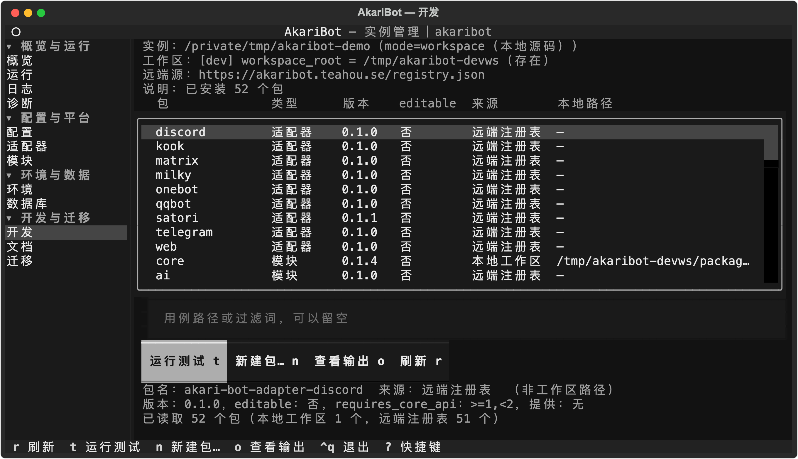

# 模块开发

本文说明从生成、安装到运行模块的完整开发流程，以及包结构、命令、Hook、配置与运行时资源。阅读前需要了解 Python 异步编程并熟悉本仓库的包管理方式。

## 准备工作

先打开一个终端，进入实例目录，执行：

```bash
akaribot tui
```

左侧为页面列表，右侧为当前页面。使用 ↑/↓ 方向键选中“开发”，按 Enter 键打开。页脚列出当前页面可用的快捷键。

开发页面列出当前实例与工作区的成员包。按 `n` 键打开“新建包”对话框。



## 生成第一个模块

在“新建包”对话框中填写以下内容：

| 字段 | 本次填写 | 说明 |
| --- | --- | --- |
| 名称 | `greet` | 模块名，建议使用小写字母、数字和下划线，不得包含空格或斜杠 |
| 类型 | 模块 | 默认值。按钮可在模块与适配器之间切换，本教程保持模块 |
| 目标目录 | `akari-modules` | 相对当前工作区根目录，未配置工作区时相对实例根目录。包将保存至该目录下的 `akari-bot-module-greet/` |
| 生成配置 | 不勾选 | 先不生成配置模板 |
| 生成数据库 | 不勾选 | 先不生成数据库与迁移 |
| 生成测试 | 勾选 | 默认已勾选，保留一条集成测试 |

使用 Tab 键在名称、类型、目标目录与三个复选项之间切换焦点，按空格键切换复选项状态，焦点移动至“生成包”后按 Enter 键确认。

按 Esc 键或选择“关闭”放弃本次填写。

生成过程中的日志显示于输出区。生成完成后状态栏提示成功，按 `o` 键查看完整输出。新建的包将展示在开发页面的包列表中。

生成的目录结构如下，其中 `akari-modules` 为上一步填写的目标目录：

```text
akari-modules/akari-bot-module-greet/
  .github/workflows/publish.yml
  README.md
  akaribot/modules/greet/__init__.py
  akaribot/modules/greet/locales/zh_cn.json
  akaribot/modules/greet/manifest.toml
  pyproject.toml
  tests/test_greet.py
```

生成配置与生成数据库两项未勾选。后续有需求时，可以补充对应的 `config.py` 与 `database/`。

### 生成的文件

| 文件 | 用途 |
| --- | --- |
| `pyproject.toml` | 包名、依赖与 `akaribot.modules` 入口 |
| `manifest.toml` | 包清单，声明语言目录与提供的模块名 |
| `akaribot/modules/greet/__init__.py` | 模块声明与命令实现 |
| `locales/zh_cn.json` | 帮助文本与回复文案 |
| `tests/test_greet.py` | 一条集成测试，核对命令回复 |
| `README.md` | 包的安装、命令与结构说明 |
| `.github/workflows/publish.yml` | 推送版本标签后上传至 PyPI 的工作流 |

### 先看生成的代码

打开 `akaribot/modules/greet/__init__.py`，其初始代码如下：

```python
"""greet 模块。"""

from akaribot.core.api import (
    Bot,
    I18NContext,
    module,
)

mod = module(
    "greet",
    desc="{I18N:greet.help.desc}",
    doc=True,
)


@mod.command()
async def _(msg: Bot.MessageSession):
    await msg.finish(I18NContext("greet.message.hello"))
```

`@mod.command()` 未指定模板时注册模块默认命令，调用形式为 `~greet default`。

`module()` 的 `desc` 参数指向模块说明。命令处理函数调用 `msg.finish()`，将 `I18NContext` 对应的本地化文案发送至当前会话。

文案保存在 `locales/zh_cn.json`：

```json
{
    "greet.help": "执行 greet 的默认命令。",
    "greet.help.desc": "greet 模块。",
    "greet.message.hello": "Hello World!"
}
```

`greet.help.desc` 为模块说明，`greet.help` 为默认命令帮助文本。回复文案当前为 `Hello World!`，后文说明修改方法。

## 修改第一条回复

打开 `locales/zh_cn.json`，将 `greet.message.hello` 修改为：

```json
"greet.message.hello": "你好，世界！"
```

若生成时保留了测试，`tests/test_greet.py` 中的预期文案也需要同步修改：

```python
@func_case
async def test_greet_default(tester: Tester):
    """default 命令返回预期文案。"""
    await tester.integrate(
        "~greet default",
        Contains("你好，世界！"),
        "greet 的 default 命令应返回预期文案",
    )
    return tester
```

当测试中的预期文案与实际文案不一致时，测试执行失败。修改回复文案后，必须同步核对 `zh_cn.json` 与测试中的预期文案。

## 安装并启用

生成的文件保存在目标目录中。切换至侧边栏“模块”页面，先按 `c` 键清除选择，再按 `i` 键打开安装对话框。

在输入框中填入所生成的包目录，请使用输出区展示的绝对路径。选择“下一步”后，终端界面（TUI）识别该目录，安装方式将展示“可编辑安装本地目录”。选中该项即可开始安装。

可编辑安装直接引用本地源码目录。安装完成后，模块页面刷新列表并展示 `greet`。

若实例正在运行，新模块将直接加载；若实例未运行，新模块在下次启动时自动加载。

安装仅负责使实例能够加载该模块。普通模块仍需要在场景内启用。场景管理员在会话中执行：

```text
~module enable greet
```

基础模块始终开启。`greet` 为普通模块，需要先启用。修改代码后，可以重启实例，或由超级用户在会话中执行：

```text
~module reload greet
```

## 对话示例

以下对话示例假定模块已完成安装，且当前场景已启用 `greet`。

<ChatExample
  :log="[
    '用户：~module enable greet',
    '机器人：成功：开启模块“greet”。',
    '用户：~greet default',
    '机器人：你好，世界！',
  ]"
/>

`~module enable greet` 仅需要执行一次。后续执行 `~greet default` 将匹配 `@mod.command()` 注册的默认命令，并返回 `zh_cn.json` 中配置的文案。

若机器人未返回响应，请先检查以下三项：

- 确认模块是否安装成功。返回“模块”页面，确认 `greet` 是否显示在列表中且状态为已安装。
- 确认当前场景是否启用模块。在会话中执行 `~module list` 核实启用状态。
- 确认修改文案后是否已重载。在会话中执行 `~module reload greet` 或重启实例。

## 继续开发

生成模板仅提供最小可运行结构。别名、平台范围、权限、配置、数据库与 Hook 可以根据需求补充。

- 修改 `module()` 的参数，可以声明别名、支持平台和模块级权限，参数参见下文“声明模块”。
- 若需要为默认命令指定其他名称，可将 `@mod.command()` 修改为 `@mod.command("hello {{I18N:greet.help.hello}}")`，并同步更新 `greet.help.hello` 与测试中的 `~greet hello`。
- 修改 `@mod.command()` 的模板可以增加位置参数、标志选项与帮助文本，具体规则参见下文“命令”。
- 若需要定时执行任务或监听消息，可以使用 `@mod.schedule()`、`@mod.hook()` 或 `@mod.event()`，用法参见对应小节。

## 包结构与清单

```text
akari-bot-module-<name>/
  pyproject.toml
  akaribot/modules/<name>/
    __init__.py         module() 声明与组件
    config.py           @on_module_config 配置模板，可选
    database/models.py  数据模型，可选
    locales/zh_cn.json  文案与配置注释
    manifest.toml       包元数据
```

`pyproject.toml` 声明依赖与入口，`manifest.toml` 声明包元数据清单字段。

```toml
# pyproject.toml
dependencies = ["akari-bot-core"]

[project.entry-points."akaribot.modules"]
dice = "akaribot.modules.dice"

# manifest.toml
schema = 1
requires_core_api = ">=1,<2"
config_table = "module_dice"
provides_modules = ["dice"]
```

示例仅列出包名。实际的版本范围从包目录下的 `pyproject.toml` 的 `dependencies` 读取，文档不重复具体约束。

清单字段如下：

| 字段 | 说明 |
| --- | --- |
| `schema` | 清单结构版本，当前为 `1` |
| `requires_core_api` | 核心 API 兼容区间，默认 `>=1,<2` |
| `locales`、`assets` | 语言文件与资源目录，默认 `locales`，相对导入包目录解析 |
| `migrations`、`config_migrations` | 数据库迁移与配置迁移目录 |
| `config_table`、`config_schema_version` | 配置表名，新生成配置写入的结构版本，默认 `1` |
| `provides_modules` | 包提供的模块名 |
| `owned_tables` | 数据清理时属于本包的数据表 |
| `credential_fields` | 启动前用于多实例查重的登录信息字段 |

未识别的键仅记录警告，不影响加载。

## 发现与加载

`PackageRegistry` 读取已安装包声明的模块入口，`load_order()` 按依赖关系确定加载顺序。模块仅依赖 `akaribot.core.api` 的公开接口。成员包缺少模块入口声明时，框架才会通过目录扫描发现模块。

JobQueue 处理完毕现有任务、Scheduler 进入维护状态后，框架方执行安装、卸载与重载。框架将替换原有的注册项，新注册项在正在运行的任务退出后生效。

模块加载失败或不兼容时，失败原因写入 `.cache_loader`，启动提示将读取该文件。`ModulesManager.reload_module()` 返回 `(状态, 重载次数)`。命令 `~module reload` 执行失败时将返回错误提示。

## 声明模块

```python
from akaribot.core.api import Bot, I18NContext, module

dice = module("dice", alias=["rd", "roll"], desc="{I18N:dice.help.desc}", doc=True)
```

`module()` 的参数如下：

| 参数 | 说明 |
| --- | --- |
| `module_name` | 命令首词，同时作为模块标识 |
| `alias` | 别名，可传字符串、列表或 `{别名: 完整命令}` 映射 |
| `desc` / `doc` / `hidden` | 帮助简介、线上说明与隐藏开关 |
| `recommend_modules` / `base` / `load` | 推荐模块、强制开启与加载开关 |
| `rss` / `regex` / `event` | 声明依赖的平台能力，影响模块能否在该场景启用 |
| `required_admin` / `required_superuser` / `required_base_superuser` | 模块级权限 |
| `required_bot_permissions` | 开启前要求机器人具备的平台权限 |
| `suppress_invalid_prompt` / `available_for` / `exclude_from` | 提示开关与平台范围 |

## 命令

```python
@dice.command("<dices> [<dc>] {{I18N:dice.help}}")
async def _(msg: Bot.MessageSession, dices: str, dc: int | None = None):
    await msg.finish(I18NContext("dice.message.result", dices=dices))
```

模板元素分四类：

- `<name>` 是位置参数，对应同名函数参数。未提供参数时使用默认值或 `None`。
- `[flag]` 是标志选项。标注为 `bool` 的函数参数将直接解析为布尔值。
- `[-b]`、`[--foo <bar>]` 是以连字符开头的选项。选项名中的下划线按连字符匹配。选项仅包含单个子参数时，直接将子参数的值传递给同名函数参数。`[-p <page>]` 也可以直接使用子参数名 `page`。无法作为参数名的元素使用 `Param` 标注。
- 模板末尾用双层花括号包裹的 `I18N:key` 是帮助文案，不参与解析。

`int`、`float`、`bool` 参数按类型标注执行转换。单个命令可注册多个模板，匹配任意一个即可生效。`priority` 数值越大，匹配优先级越高。

非基础模块的命令默认需要在场景内启用该模块后才可执行。声明 `available_without_enable=True` 后，该命令不受场景启用状态限制，未启用模块时也能直接执行：

```python
@dice.command("verify <token> {{I18N:dice.help.verify}}", available_without_enable=True)
async def _(msg: Bot.MessageSession, token: str):
    ...
```

解析结果写入 `parsed_msg`，位置参数以模板中的参数名为键。

以连字符开头的选项以选项名作为键。`-l` 与 `--l` 按同一选项处理，选项名中的下划线映射为连字符。

函数中标注为 `Bot.MessageSession` 的参数由框架注入，其余参数按名称从 `parsed_msg` 读取。类型转换失败时抛出 `InvalidCommandFormatError` 异常。

## 等待用户交互

命令执行过程中需要等待用户输入时，可使用 `MessageSession` 提供的等待方法。此类方法会暂停当前命令执行流程，在收到目标消息后再继续执行。

| 方法 | 适合的场景 | 返回 |
| --- | --- | --- |
| `wait_confirm()` | 仅需要用户确认是或否 | `bool` |
| `wait_next_message()` | 收集同一用户的下一条消息 | `MessageSession` |
| `wait_reply()` | 要求用户引用某条提示再回复 | `MessageSession` |
| `wait_anyone()` | 让场景内任意成员回答 | `MessageSession` |

等待方法默认最长等待 120 秒。等待期间默认释放执行互斥锁，返回前重新获取。发生超时、用户取消或重新获取锁失败时，均抛出 `WaitCancelException`。

以下示例在 `greet` 模块中追加命令，对应文案键需要写入 `locales/zh_cn.json`。

```python
from akaribot.core.api import Bot, I18NContext, WaitCancelException
```

### 等待确认

```python
@greet.command("reset")
async def _(msg: Bot.MessageSession):
    try:
        confirmed = await msg.wait_confirm(
            I18NContext("greet.message.reset.confirm"),
            timeout=60,
        )
    except WaitCancelException:
        await msg.finish(I18NContext("greet.message.timeout"))
        return
    if not confirmed:
        await msg.finish(I18NContext("greet.message.cancelled"))
        return
    await msg.finish(I18NContext("greet.message.reset.done"))
```

`wait_confirm()` 默认引用原消息，并在收到回复后删除机器人发出的提示。该方法仅将确认词作为有效回答，用户发送其他内容时保持等待。

执行删除数据、解绑账号等不可逆操作时，可以传入 `confirm_token` 要求用户原样回复该口令。

### 收集下一条消息

```python
@greet.command("rename")
async def _(msg: Bot.MessageSession):
    try:
        reply = await msg.wait_next_message(
            I18NContext("greet.message.rename.prompt"),
            delete=True,
            timeout=60,
        )
    except WaitCancelException:
        await msg.finish(I18NContext("greet.message.timeout"))
        return
    name = reply.as_display(text_only=True).strip()
    if not name:
        await msg.finish(I18NContext("greet.message.rename.empty"))
        return
    await msg.finish(I18NContext("greet.message.rename.done", name=name))
```

`wait_next_message()` 等待触发当前命令的用户发送下一条消息。该消息仍会进入常规命令解析流程；若用户发送命令，该命令会正常执行，且不会完成这次等待。等待会保持到收到非命令消息或超时。设置 `delete=True` 时，将在等待结束后删除机器人发出的提示消息。

### 等待引用回复

```python
@greet.command("apply")
async def _(msg: Bot.MessageSession):
    try:
        reply = await msg.wait_reply(
            I18NContext("greet.message.apply.prompt"),
            timeout=120,
        )
    except WaitCancelException:
        await msg.finish(I18NContext("greet.message.timeout"))
        return
    note = reply.as_display(text_only=True).strip()
    await msg.finish(I18NContext("greet.message.apply.done", note=note))
```

`wait_reply()` 等待用户引用机器人发出的提示消息回复。若平台不支持引用回复功能，将自动转为等待下一条消息；传入 `all_=True` 时等待场景内任意成员回复。

### 等待任何人回答

```python
@greet.command("quiz")
async def _(msg: Bot.MessageSession):
    try:
        reply = await msg.wait_anyone(
            I18NContext("greet.message.quiz.prompt"),
            timeout=30,
        )
    except WaitCancelException:
        await msg.finish(I18NContext("greet.message.quiz.timeout"))
        return
    answer = reply.as_display(text_only=True).strip()
    await msg.finish(I18NContext("greet.message.quiz.result", answer=answer))
```

`wait_anyone()` 等待场景内首个回答的成员。成员可以直接发送消息，也可以引用提示回复，适用于抢答、投票与多人协作场景。其提示文本需要在 `greet.message.quiz.prompt` 中说明回答规则。

仅需要暂停数秒时，可以调用 `await msg.sleep(3)`。该方法与等待方法一致，均会在暂停期间释放执行锁。

<NoticeBox type="warning" title="等待异常">

`WaitCancelException` 与 `SessionFinished` 继承自 `BaseException`，普通的 `except Exception` 无法捕获。等待超时、用户取消与会话结束需要分别捕获处理。

</NoticeBox>

## 正则匹配

常规命令必须包含命令前缀才能触发。通过正则匹配时，若消息文本匹配正则表达式规则，对应的处理函数就会执行。正则匹配适用于识别链接、固定编号与特定格式的文本。

以下示例说明通过正则识别视频编号的方法，其中 `bili` 为模块实例变量：

```python
import re

from akaribot.core.api import Bot, PlainElement

@bili.regex(
    r"av(\d+)\b",
    flags=re.I,
    mode="A",
    desc="{I18N:bilibili.help.regex.av}",
    element_filter=(PlainElement,),
)
async def _(msg: Bot.MessageSession):
    for video_id in msg.matched_msg[:5]:
        # 演示用，实际项目应使用 I18NContext 组装视频信息
        await msg.send_message(f"找到 av{video_id}")
```

`mode="A"` 使用 `findall` 查找消息中的全部匹配项并执行去重。`msg.matched_msg` 为匹配文本组成的元组。示例仅保留前 5 项以避免单条消息触发过多回复。示例回复文本仅供演示，实际开发中请替换为查询所得的视频详情。

`mode="M"` 使用 `re.match`，仅从文本开头执行匹配。匹配成功后 `msg.matched_msg` 为正则的 Match 对象，可调用 `group()` 获取捕获组：

```python
from akaribot.core.api import Bot, I18NContext

@greet.regex(r"签到 (\d+)", mode="M")
async def _(msg: Bot.MessageSession):
    count = int(msg.matched_msg.group(1))
    await msg.finish(I18NContext("greet.message.sign", count=count))
```

常用选项：

- `trigger_once_startup=True` 使每个场景仅在启动后触发一次，适用于发送迁移提示或一次性公告。
- `skip_long_message_confirm=True` 跳过超长消息确认流程，仅在对匹配结果具有明确预期时使用。
- `element_filter=(PlainElement,)` 仅匹配纯文本元素，避免将图片说明或提及视为正文内容。

正则处理函数在接收到每条消息时均会运行，应保持轻量。网络请求与大量遍历操作应交由后台任务处理。

## 定时任务

`@greet.schedule()` 注册后台任务。任务函数不接收 `msg`，也没有会话上下文。需要主动发送消息时，请使用 `Bot.post_message()`。

每天凌晨 4 点清理模块缓存：

```python
from akaribot.core.api import CronTrigger

@greet.schedule(CronTrigger.from_crontab("0 4 * * *"))
async def clean_cache():
    for path in greet.cache_path("tmp").glob("*.tmp"):
        path.unlink(missing_ok=True)
```

`CronTrigger.from_crontab()` 接收五段 crontab 表达式，依次为分钟、小时、日期、月份与星期，并按实例时区计算下一次执行时间。

每 30 分钟检查一次更新：

```python
from akaribot.core.api import IntervalTrigger

@greet.schedule(IntervalTrigger(minutes=30))
async def refresh():
    ...
```

`IntervalTrigger` 的触发间隔受配置项 `schedule_interval_multiplier` 的倍数缩放影响。测试或调试阶段可以通过该配置项缩短触发周期。

定时任务也可以主动推送消息。以下任务于每周一上午 9 点向启用了 `greet` 的场景推送提醒：

```python
@greet.schedule(CronTrigger.from_crontab("0 9 * * MON"))
async def weekly_report():
    await Bot.post_message("greet", I18NContext("greet.message.weekly"))
```

`Bot.post_message()` 仅发送至启用了 `greet` 的场景。

定时任务还接受 `DateTrigger`，也可以用 `AndTrigger`、`OrTrigger` 组合多个触发器。同一个函数可以叠加多个 `@schedule`，每个装饰器注册一个任务。

模块未加载时，其命令、正则与定时任务均不执行。场景未启用非基础模块时，该模块的命令与正则将在 `parser_policies` 的模块匹配阶段被拦截。

## Hook 与事件

Hook 挂载在消息处理链的固定位置，用于观察或改变处理结果。Hook 不替代命令，适用于统计、拦截、错误提示与平台事件响应。

### 命令执行后统计

```python
from akaribot.core.api import Bot, HookPoint, Logger

@greet.hook(point=HookPoint.EXECUTION_FINISHED, priority=50, name="count")
async def _(ctx: Bot.ParserHookContext):
    if ctx.module_name != "greet":
        return
    Logger.info(f"greet 执行完成: {ctx.command_first_word}")
```

在 `EXECUTION_FINISHED` 阶段，Hook 的返回值将被忽略。`priority` 数值越小越优先执行，默认值为 100。`timeout` 默认等待 5 秒，小于或等于 0 时表示不限制执行时间。

`server_scope=True` 的 Hook 不受场景内模块开关限制，但全局停用状态与平台范围仍会拦截它。

### 拦截出站消息

```python
@greet.hook(point=HookPoint.OUTGOING_BEFORE_SEND, priority=10, name="mute_guard")
async def _(ctx: Bot.ParserHookContext):
    if ctx.session_info.fetch and ctx.session_info.muted:
        return ctx.Stop()
```

`OUTGOING_BEFORE_SEND` 在消息发送至平台前执行。返回 `ctx.Stop()` 可以取消当次发送，也可以修改 `ctx.outgoing.chain` 调整发送内容。该挂载点同时作用于命令回复与 `Bot.post_message()` 的主动推送，适用于在机器人被禁止发言的场景下拦截出站消息。

### 处理执行错误

```python
@greet.hook(point=HookPoint.EXECUTION_ERROR, priority=90, name="friendly_error", timeout=0)
async def _(ctx: Bot.ParserHookContext):
    if ctx.module_name != "greet":
        return
    error = ctx.data.get("error")
    if not isinstance(error, Exception):
        return
    Logger.error(f"greet 执行失败: {error!r}")
    await ctx.msg.send_message(I18NContext("greet.message.error"))
    return ctx.Handled()
```

`EXECUTION_ERROR` 的 `ctx.data` 包含 `error`、`module_type`，部分错误还包含 `error_kind`。返回 `ctx.Handled()` 表示异常已处理完毕，框架不再记录未处理错误日志。处理逻辑应仅拦截已知异常，未识别异常交由默认错误流程处理。

### 响应平台事件

```python
from akaribot.core.api import Bot, Logger

@greet.event("member_joined", available_for="QQBot|Group")
async def _(event: Bot.EventInfo):
    Logger.info(f"新成员加入: {event.target_id}, {event.sender_id}")
```

`@greet.event("事件名")` 用于订阅适配器上报的平台事件，不进入命令解析流程，且不提供 `msg` 上下文。`available_for` 用于限定适用的平台与场景类型。

事件字段由适配器提供，常用 `target_id`、`sender_id` 和 `data`。需要发送欢迎语时，先将事件目标转换为会话对象，再调用发送方法。

`HookPoint` 有以下阶段：

- 会话与消息：`SESSION_READY`、`SESSION_BEFORE_WAIT`、`MESSAGE_NORMALIZED`。
- 命令处理：`COMMAND_PREPARE`、`COMMAND_BEFORE_PARSE`、`COMMAND_BEFORE_EXECUTE`、`COMMAND_ROUTE`、`COMMAND_UNMATCHED`。
- 正则匹配：`REGEX_ROUTE`、`REGEX_CANDIDATE`、`CHANNEL_CLAIM`、`REGEX_PREPARE`、`REGEX_BEFORE_EXECUTE`。
- 执行：`EXECUTION_FINISHED`、`EXECUTION_ERROR`、`FINISHED`。
- 出站：`OUTGOING_BEFORE_SEND`、`OUTGOING_SENT`、`OUTGOING_FAILED`。

在模块匹配或候选阶段，Hook 返回 `Stop` 将终止后续处理流程。

带名称的 Hook 按 `模块名.钩子名` 格式注册。`Bot.Hook.trigger("模块.钩子")` 仅调用该模块注册的回调函数。名称中不包含点号时，调用广播给所有同名 Hook。若某个回调执行失败，框架记录错误日志后继续执行其余回调。

## 权限

模块级 `required_*` 对所有命令生效。命令上配置的权限仅能比模块级更严格。

运行阶段可以调用 `await msg.check_permission()` 判断当前用户是否为场景管理员，调用 `msg.check_super_user()` 判断是否为超级用户。

基础模块始终开启；普通模块需要在场景内执行 `~module enable` 启用后才能使用。`~auth` 可为单个用户授予模块级超级用户权限。

## 配置、数据库与本地化

- 配置在 `config.py` 中用 `@on_module_config("<模块>")` 声明，表名为 `module_<模块>`。配置注释保存在 `config.comments.module_<模块>.<字段名>` 下。参见[配置](config.md)。
- 模型保存在 `database/models.py`，继承 `DBModel`，表名在 `Meta.table` 中声明。新增表需要写入 `owned_tables`。结构变更通过 `migrations/` 下的脚本执行。参见[数据库](database.md)。
- 文案一律使用 `I18NContext("key", **参数)`，且仅在所属包的 `locales/zh_cn.json` 中创建对应条目。参见[本地化](i18n.md)。

## 常用工具

- `CoolDown(key, msg, delay, whole_target=False)`：按用户或整个场景记录冷却时间，`check()` 返回剩余秒数。
- `gained_petal()`、`lost_petal()`、`cost_petal()`、`sign_get_petal()`、`reset_petals_if_due()`：查询与变更花瓣余额，并在回复消息中提示。
- `PlayState(game, msg)`：按会话保存小游戏状态。默认在 3600 秒（`GAME_EXPIRED`）后过期。`running()` 作为上下文管理器标记运行中状态。`disable()` 会取消开启该局命令仍挂起的等待任务，等待方随即以 `WaitCancelException` 结束。`_status`、`_generation` 与 `_session` 是保留键，不要用 `update()` 覆盖。

## 运行时资源

`Bind.Module` 提供由框架管理的资源接口：

- `state()` 跨重载保留进程内状态。
- `cache()` 在版本变化时失效。
- `resource()` 首次使用时加载，并在关闭时释放。
- `cache_path()` 返回框架管理的缓存目录。
- `cleanup()` 注册退出清理。
- `spawn()` 创建由框架跟踪的后台任务。

重载模块将替换原有的注册项，并等待正在运行的任务完成退出。

## 会话接口

`send_message()` 发送消息，返回 `FinishedSession`。`finish()` 发送消息后结束当前处理，并抛出 `SessionFinished`。

`wait_confirm()`、`wait_next_message()`、`wait_reply()`、`wait_anyone()` 的用法参见上文“等待用户交互”。`sleep()` 在暂停期间释放执行锁。

`delete()` 删除触发消息。`hold()`、`release()` 保持和释放平台上下文。

同一用户已有命令处于执行状态时，机器人将拒绝后续新发起的命令，并提示“当前有命令正在执行，请稍后再试。”
