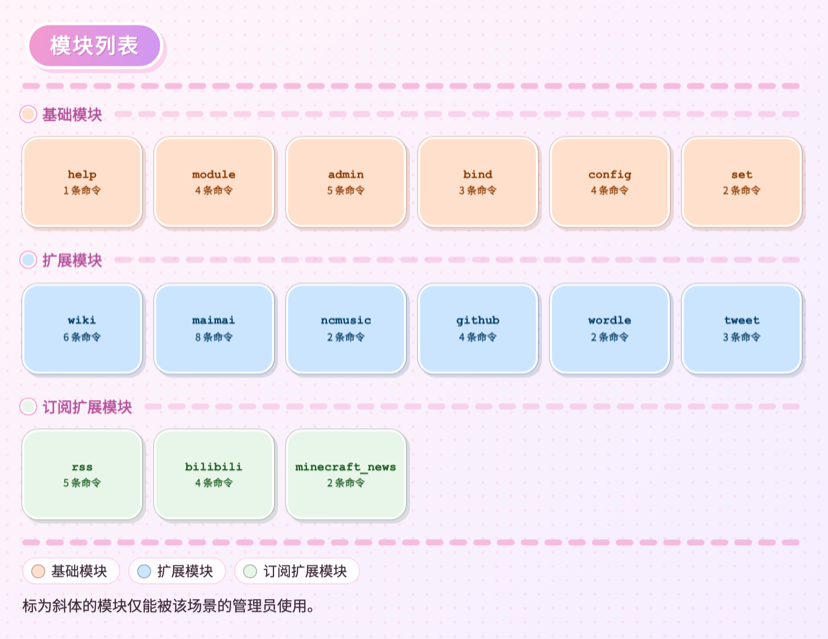

# help

基础模块，输出模块清单与命令帮助。

### `help`

<CommandUsage :usage="['help [--legacy] [--img]', 'help <module> [--legacy] [--img]']" :params="['module=模块名或别名']" permission="public" :options="[{flag: '--legacy', desc: '强制使用文本模式'}, {flag: '--img', desc: '强制使用图片模式'}]" />

- 省略模块名时，按当前场景可用的模块列出清单与启用状态。
- 清单带锁定与订阅标记，以及启用、停用入口。
- `hidden=True` 的模块不出现；平台不支持的模块以删除线标注。
- 给出模块名时，展示该模块的简介与命令模板。
- 超级用户命令对非超级用户隐藏，管理员命令对普通成员隐藏。

<ChatExample
  :log="[
    '用户：~help bind',
    '机器人：管理用户组、场景组与消息通道，同一组内的用户或群聊共享同一份数据。',
    '`~bind self remove <user>` - 将指定用户移出当前用户组。',
    '`~bind token <code>` - 填入另一处生成的绑定码以完成绑定。',
  ]"
/>

## 输出样式

### Markdown 表格（QQBot）

平台支持 Markdown 扩展时（QQBot 使用这种样式），模块清单排成一张表；模块名可点击填入对应的 `help` 命令。

<ChatExample
  :messages="[
    { role: 'user', text: '~help' },
    {
      role: 'bot',
      markdown: true,
      text: '| AkariBot | 简体中文 | 版本：v0.1.1 | 权限：管理员 |\n| --- | --- | --- | --- |\n| 基础模块 | | | |\n| 🔓 help | 🔓 module | 🔓 admin | 🔓 bind |\n| 扩展模块 | 🔓 = 已开启 | 🔐 = 已关闭 | |\n| 🔓 wiki | 🔓 maimai | 🔓 ncmusic | 🔓 rss |\n| 订阅扩展模块 | 🔔 = 已开启 | 🔕 = 已关闭 | |\n| 🔔 rss | 🔔 bilibili | 🔔 minecraft_news | |\n\n向右滑动以查看所有模块，点击可自动填入对应帮助命令。',
    },
  ]"
/>

示例为静态表格；实际消息里的语言、版本与模块名是填入对应命令的指令操作。

### 图片模块列表

未启用 Markdown 表格、平台支持图片且未强制文本模式时，模块清单渲染为一张图片。模块按基础、扩展、订阅分组，未开启的模块单独着色。

<ChatExample
  :image-width="720"
  :messages="[
    { role: 'user', text: '~help' },
    { role: 'bot', text: '' },
  ]"
/>

### 文本模式

`--legacy`、Markdown 表格不可用或图片渲染失败时，模块清单按分组输出为纯文本，模块之间用 `|` 分隔。

<ChatExample
  :log="[
    '用户：~help --legacy',
    '机器人：基础模块：',
    '🔓 help | 🔓 module | 🔓 admin | 🔓 bind',
    '扩展模块：',
    '🔓 wiki | 🔓 maimai | 🔓 ncmusic | 🔓 rss',
    '使用“~help <模块名称>”查看详细信息。',
  ]"
/>

`--img` 优先渲染图片，渲染不可用时回退文本；`--legacy` 强制文本模式。模块顺序与启用状态取自场景的 `modules` 列，基础模块始终显示为已启用；未启用的模块可通过清单按钮或 `module enable <module>` 打开。模块的帮助文案来自命令模板末尾的 `I18N:key`，简介来自 `module(desc=...)`。
