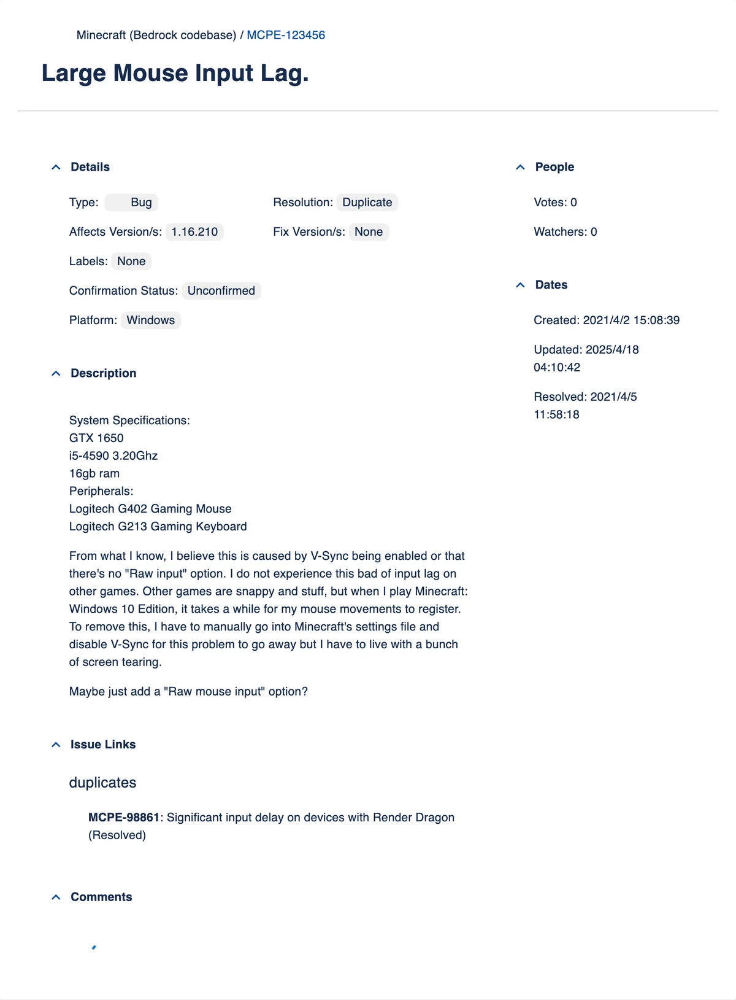

# bugtracker

此模块可以按漏洞编号查询 Mojira（Mojang 漏洞追踪器）中的记录。查询结果包含标题、类型、状态、项目、优先级、解决状态和关联版本，并附上原文链接与页面截图。简体中文会话还会附带 spx 社区翻译。

## 命令

<ModuleAlias names="bug" />

### `bugtracker`

<CommandUsage usage="bugtracker <mojiraid>" :params="['mojiraid=Mojira 漏洞编号，含项目前缀']" permission="public" />

此命令用于查询漏洞编号对应的记录。`<mojiraid>` 须为“项目前缀-数字”的形式，例如 `MCPE-123456`。

编号无法解析时返回无效编号的提示。项目或漏洞不存在时返回查询失败的提示。

<ChatExample
  :log="[
    '用户：~bugtracker MCPE-123456',
    '机器人：[MCPE-123456] Large Mouse Input Lag.',
    'Type: Bug | Status: Resolved',
    'Resolution: Duplicate',
    '',
  ]"
/>

## 正则触发

消息以漏洞编号开头时，机器人自动查询，支持以下写法：

- 裸编号，如 `MCPE-123456`。
- 方括号包裹的编号，如 `[MCPE-123456]`。
- 完整链接，如 `https://bugs.mojang.com/browse/MCPE/issues/MCPE-123456`。

可识别的项目前缀为 `BDS`、`MCPE`、`MCD`、`MCL`、`MCLG`、`REALMS`、`MC`、`WEB`，大小写不敏感。单条消息最多处理前 5 个匹配。
