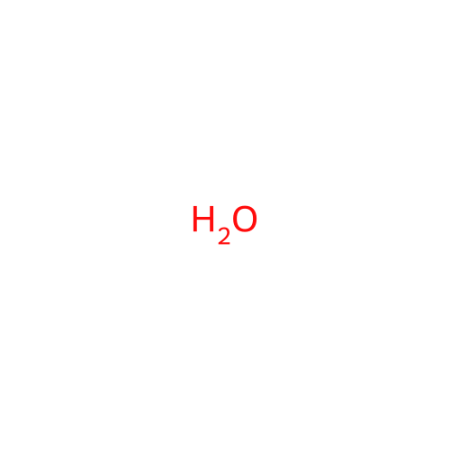

# chemical-code

随机取一个化合物，绘制结构图让玩家回答分子式。答错时按元素组成给出提示，答对按模式发放花瓣。

## 命令

### `chemical-code`

<CommandUsage :usage="['chemical-code', 'chemical-code <pcid>']" :params="['pcid=PubChem 化合物编号，0 为随机']" permission="public" :aliases="['chemical_code', 'cc', 'chemicalcode', 'ccode']" />

经典模式随机取一个化合物出题，答对获得 1 花瓣。填写 PubChem CID 时按该 CID 出题，`0` 表示随机，负数返回无效提示；该模式不发花瓣。

<ChatExample
  :log="[
    '用户：~chemical-code 962',
    '机器人：请在 `2` 分钟内回答这个化合物的分子式。（除 C、H 外使用字母表顺序，如：CHBrClF）',
    '',
    '用户：H2O',
    '机器人：回答正确。',
  ]"
/>

### `chemical-code captcha`

<CommandUsage usage="chemical-code captcha" permission="public" :aliases="['cca', 'chemical_captcha', 'chemicalcaptcha', 'ccaptcha']" />

验证码模式出题：只接受一次作答，答对获得 2 花瓣。

<ChatExample
  :log="[
    '用户：~chemical-code captcha',
    '机器人：请回答这个化合物的分子式。（除 C、H 外使用字母表顺序，如：CHBrClF）',
    '用户：H2O',
    '机器人：回答正确。',
  ]"
/>

### `chemical-code stop`

<CommandUsage usage="chemical-code stop" permission="public" />

结束当前对局并公布答案。

<ChatExample
  :log="[
    '用户：~chemical-code stop',
    '机器人：已停止，正确答案是 H2O。',
  ]"
/>

题目附带 PubChem CID。答案按分子式比对，大小写与顺序敏感；发送的内容为字母与数字组合时会被解析为分子式并给出提示：元素总数偏差过大、缺少元素、元素数量不符三类提示分别触发。

经典模式在题目发送后开始计时，时限按分子中的原子数折算：每 30 个原子 1 分钟，最少 2 分钟；超时公布答案。同一会话已有对局时返回进行中提示；对局按会话隔离，1 小时未活动即过期，机器人服务重启后对局中断。
