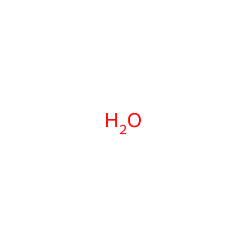

# chemical-code

此模块随机选取一个化合物，绘制结构图并由玩家回答分子式。答错时按元素组成提供提示，答对后按模式发放花瓣。

## 命令

### `chemical-code`

<CommandUsage :usage="['chemical-code', 'chemical-code <pcid>']" :params="['pcid=PubChem 化合物编号，0 为随机']" permission="public" :aliases="['chemical_code', 'cc', 'chemicalcode', 'ccode']" />

经典模式随机选取一个化合物出题，答对后获得 1 个花瓣。填写 PubChem CID 时，机器人按该 CID 出题，传入 `0` 时表示随机选取，传入负数时返回参数无效提示。指定 CID 出题不发放花瓣。

<ChatExample
  :log="[
    '用户：~chemical-code 962',
    '机器人：请在 `2` 分钟内回答这个化合物的分子式。（除 C、H 外使用字母表顺序，如：CHBrClF）',
    '',
    '用户：H2O',
    '机器人：回答正确。',
  ]"
/>

### `chemical-code captcha`

<CommandUsage usage="chemical-code captcha" permission="public" :aliases="['cca', 'chemical_captcha', 'chemicalcaptcha', 'ccaptcha']" />

验证码模式出题，仅接受一次作答。答对后获得 2 个花瓣。

<ChatExample
  :log="[
    '用户：~chemical-code captcha',
    '机器人：请回答这个化合物的分子式。（除 C、H 外使用字母表顺序，如：CHBrClF）',
    '用户：H2O',
    '机器人：回答正确。',
  ]"
/>

### `chemical-code stop`

<CommandUsage usage="chemical-code stop" permission="public" />

此命令用于结束当前对局并公布答案。

<ChatExample
  :log="[
    '用户：~chemical-code stop',
    '机器人：已停止，正确答案是 H2O。',
  ]"
/>

出题消息中附带 PubChem CID。答案按分子式比对，区分大小写与元素顺序。玩家发送的内容为字母与数字组合时，机器人会按分子式解析，并按偏差类型返回对应提示：

- 元素总数偏差过大
- 缺少元素
- 元素数量不符

经典模式在题目发送后开始计时。时限按分子中的原子数折算，每 30 个原子折算 1 分钟，最少为 2 分钟。超时后自动公布答案。

若当前会话中已存在进行中的对局，机器人返回进行中提示。对局按会话隔离，若 1 小时内无活动则自动过期。机器人服务重启后，当前对局将自动中断。
