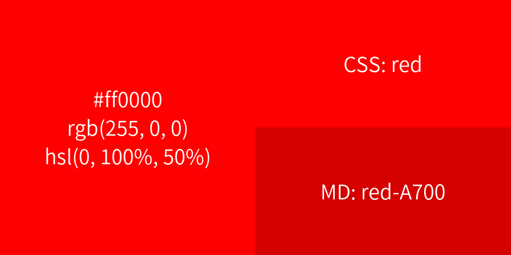

# color

此模块用于解析颜色代码，返回十六进制色值、RGB 与 HSL 三种表示，以及最接近的 CSS 与 Material Design 颜色名称。结果同时附带一张包含全部信息的色卡图片。

## 命令

<ModuleAlias names="colour" />

### `color`

<CommandUsage usage="color [<color>]" :params="['color=颜色代码或颜色名称，省略则随机']" permission="public" />

此命令用于解析颜色代码，返回色值、最接近的 CSS 与 Material Design 颜色名称以及色卡图片。省略参数时随机取一个颜色，遇到无法识别的颜色格式时给出提示。

结果以 Embed 卡片输出，包含十六进制、RGB、HSL 三种色值与两个颜色名称字段。

对应名称表中存在完全一致的色值时，字段名为“CSS 颜色名称”或“Material Design 颜色名称”，否则为“最相似的 CSS 颜色名称”或“最相似的 Material Design 颜色名称”。

此命令支持以下输入形式，完整名称表见[颜色名称表](colors.md)。

- CSS 颜色名称，如 `rebeccapurple`、`cornflowerblue`。
- Material Design 颜色名称，如 `red-500`、`bluegrey-200`。
- 十六进制色值，3 位或 6 位，可省略 `#`，如 `#f00`、`336699`。
- `rgb(255, 0, 0)` 与百分比形式 `rgb(100%, 0%, 0%)`。
- `hsl(0, 100%, 50%)` 与带角度单位的形式 `hsl(0deg, 100%, 50%)`。

颜色名称与 Material Design 名称必须精确匹配。十六进制色值中的字母不区分大小写。

<ChatExample
  :log="[
    '用户：~color #ff0000',
    '机器人：HEX：`#ff0000`',
    'RGB：`rgb(255, 0, 0)`',
    'HSL：`hsl(0, 100%, 50%)`',
    '',
  ]"
/>
