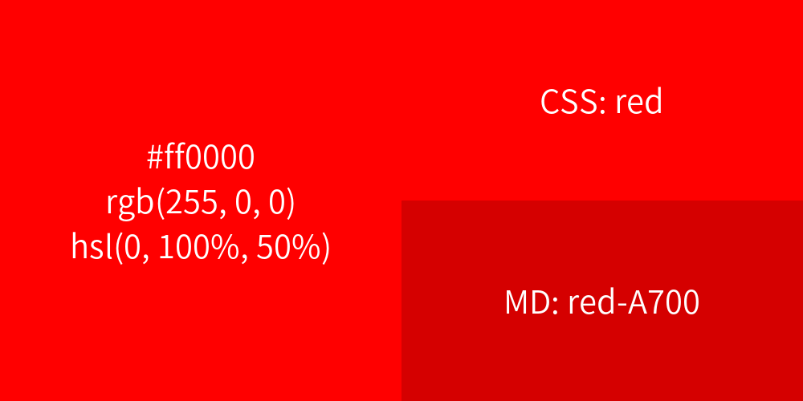

# color

此模块用于解析颜色代码，返回十六进制色值、RGB 与 HSL 三种色彩表示形式，以及最接近的 CSS 与 Material Design 颜色名称。输出结果同时附带一张包含完整信息的色卡图片。

## 命令

<ModuleAlias names="colour" />

### `color`

<CommandUsage usage="color [<color>]" :params="['color=颜色代码或颜色名称，省略则随机']" permission="public" />

此命令用于解析颜色代码，返回色值、最接近的 CSS 与 Material Design 颜色名称以及色卡图片。若未提供参数，命令将随机选取一种颜色。若传入无法识别的颜色格式，则返回错误提示。

查询结果以 Embed 卡片形式输出，包含十六进制、RGB、HSL 三种色值以及两项颜色名称字段。

若对应的颜色名称表中存在完全一致的色值，字段名称显示为“CSS 颜色名称”或“Material Design 颜色名称”。若未找到完全匹配的色值，字段名称则显示为“最相似的 CSS 颜色名称”或“最相似的 Material Design 颜色名称”。

此命令支持下列输入形式，完整名称清单请参阅[颜色名称表](colors.md)。

- 标准 CSS 颜色名称，例如 `rebeccapurple` 与 `cornflowerblue`。
- Material Design 规范颜色名称，例如 `red-500` 与 `bluegrey-200`。
- 3 位或 6 位十六进制色值，支持省略前缀 `#`，例如 `#f00` 与 `336699`。
- 函数表示形式 `rgb(255, 0, 0)` 与百分比形式 `rgb(100%, 0%, 0%)`。
- 函数表示形式 `hsl(0, 100%, 50%)` 与包含角度单位的形式 `hsl(0deg, 100%, 50%)`。

CSS 颜色名称与 Material Design 颜色名称均要求精确匹配。十六进制色值中的英文字母不区分大小写。

<ChatExample
  :log="[
    '用户：~color #ff0000',
    '机器人：HEX：`#ff0000`',
    'RGB：`rgb(255, 0, 0)`',
    'HSL：`hsl(0, 100%, 50%)`',
    '',
  ]"
/>
