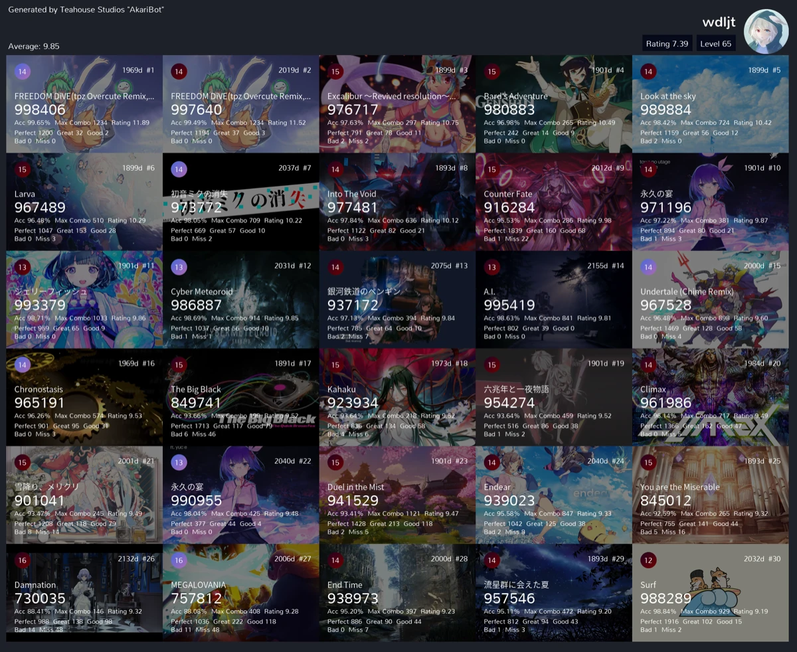
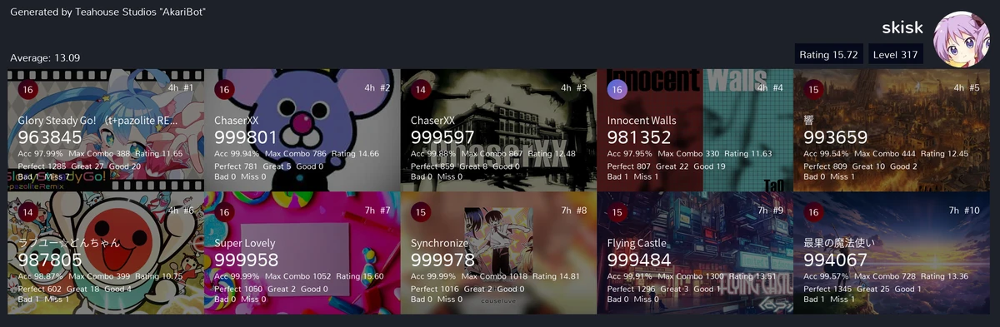

# cytoid

此模块用于查询 Cytoid 玩家资料，生成 B30（最佳 30 首）与 R10（最近 10 首）成绩图，并记录发送者的账号绑定。

## 命令

<ModuleAlias names="ctd" />

### `cytoid profile`

<CommandUsage usage="cytoid profile [<username>]" :params="['username=Cytoid 用户名']" permission="public" />

此命令查询用户资料，返回头像图片，以及经验、等级、Rating 和评级分布。省略用户名时，机器人查询发送者绑定的账号。没有绑定时，命令提示先执行 `cytoid bind`。用户不存在时返回未找到提示。

<ChatExample
  :log="[
    '用户：~cytoid profile',
    '机器人：未绑定用户，请使用“`~cytoid bind`”绑定一个用户。',
  ]"
/>

### `cytoid b30`

<CommandUsage usage="cytoid b30 [<username>]" :params="['username=Cytoid 用户名']" permission="public" />

此命令生成 B30 成绩图。省略用户名时，机器人查询发送者绑定的账号。没有绑定时，命令提示先执行 `cytoid bind`。拉取成绩失败时，命令返回获取失败提示。

<ChatExample
  :log="[
    '用户：~cytoid b30 wdljt',
    '机器人：',
  ]"
/>

### `cytoid r10`

<CommandUsage usage="cytoid r10 [<username>]" :params="['username=Cytoid 用户名']" permission="public" />

此命令生成 R10 成绩图。参数与 `cytoid b30` 相同。没有绑定时，命令同样提示先执行 `cytoid bind`。

<ChatExample
  :log="[
    '用户：~cytoid r10 skisk',
    '机器人：',
  ]"
/>

### `cytoid bind`

<CommandUsage usage="cytoid bind <username>" :params="['username=要绑定的 Cytoid 用户名']" permission="public" />

此命令绑定 Cytoid 用户名。绑定按发送者保存，同一用户在任何会话中都能使用这份绑定。用户名不存在时返回绑定失败提示。

<ChatExample
  :log="[
    '用户：~cytoid bind cytoid',
    '机器人：绑定成功：Cytoid Admin(cytoid)',
  ]"
/>

### `cytoid unbind`

<CommandUsage usage="cytoid unbind" permission="public" />

此命令解除发送者的账号绑定。解绑后，查询类命令需要重新执行 `cytoid bind`。

<ChatExample
  :log="[
    '用户：~cytoid unbind',
    '机器人：解绑成功。',
  ]"
/>
