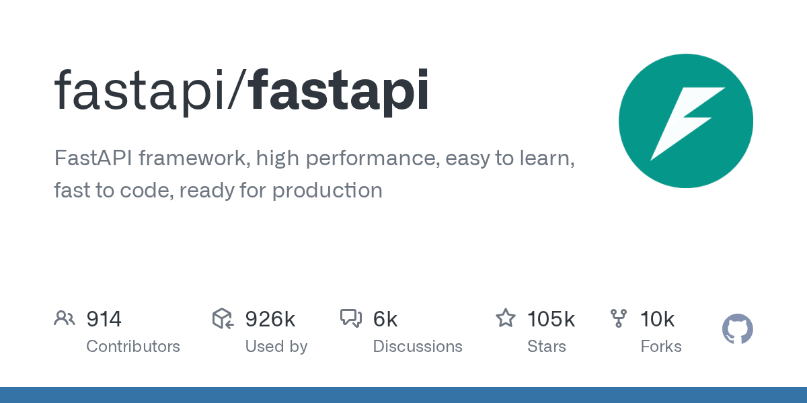

# github

此模块用于查询 GitHub 仓库、用户或组织的信息，也支持按关键词搜索仓库。仓库结果包含 Star 数、Fork 数、语言与许可证。用户结果包含关注数、公开仓库数与最近活跃时间。

## 命令

<ModuleAlias names="gh" />

### `github`

<CommandUsage usage="github <name>" :params="['name=仓库全名或用户名']" permission="public" />

按名称自动识别对象类型。名称含 `/` 时查询仓库，否则查询用户或组织。

<ChatExample
  :log="[
    '用户：~github python/cpython',
    '机器人：python/cpython (81598961)',
    'Fork · 32000 | Star · 66000 | Watch · 2100',
    'Language: Python | License: MIT',
  ]"
/>

### `github repo`

<CommandUsage usage="github repo <name>" :params="['name=仓库全名，格式为所有者/名称']" permission="public" />

查询仓库的 Star 数、Fork 数、语言与许可证，并附带 OpenGraph 预览图。仓库不存在时返回未找到提示。

<ChatExample
  :log="[
    '用户：~github repo tiangolo/fastapi',
    '机器人：tiangolo/fastapi (160919119)',
    'FastAPI framework, high performance, easy to learn, fast to code, ready for production',
    'Fork · 6500 | Star · 85000 | Watch · 1300',
    '',
  ]"
/>

### `github user`

<CommandUsage usage="github user <name>" :params="['name=用户名或组织名']" permission="public" />

查询用户或组织的关注数、公开仓库数与最近活跃时间。名称不存在时返回未找到提示。

<ChatExample
  :log="[
    '用户：~github user torvalds',
    '机器人：torvalds aka Linus Torvalds (1024025)',
    'Type · User | Follower · 234000 | Following · 0',
    'Repo · 8 | Gist · 0',
  ]"
/>

### `github search`

<CommandUsage usage="github search <keyword>" :params="['keyword=仓库搜索关键词']" permission="public" />

按关键词搜索仓库，最多列出 5 条结果。无匹配时返回未找到提示。

<ChatExample
  :log="[
    '用户：~github search python',
    '机器人：搜索结果：',
    'python/cpython: https://github.com/python/cpython',
    'python/peps: https://github.com/python/peps',
  ]"
/>
