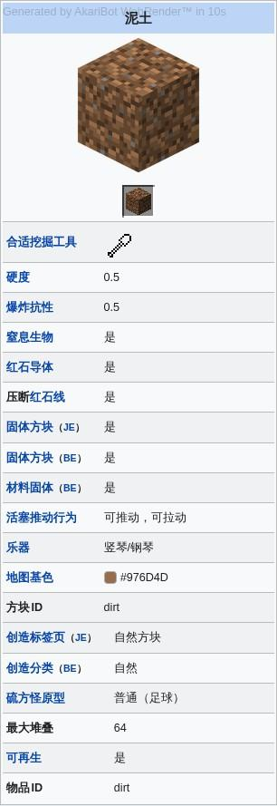
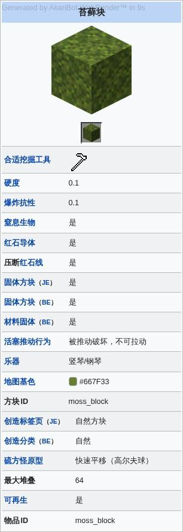
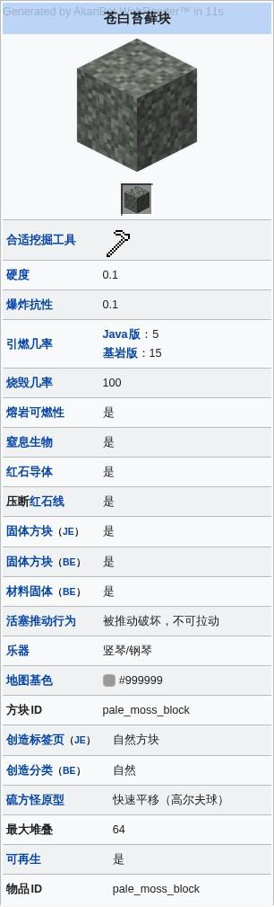
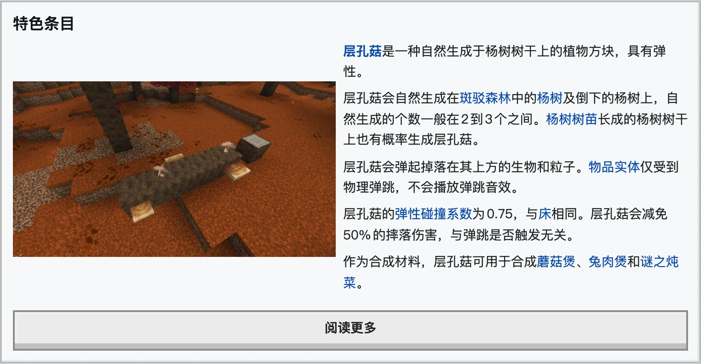

# wiki

面向 MediaWiki 站点的工具包：查询页面与模板、按 InterWiki 跳转、自定义请求头与前缀、审核 Wiki API 地址、管理 Wiki 机器人账号、监控滥用日志与最近更改，以及订阅中文 Minecraft Wiki 的每周页面与茶馆周报。

`wiki`、`ab`、`rc`、`newbie`、`user` 的查询使用当前场景设置的默认 Wiki；`wiki-audit` 与 `wiki-bot` 不依赖默认 Wiki。

## wiki

### `wiki`

<CommandUsage :usage="['wiki', 'wiki <pagename> [-l <lang>]']" :params="['pagename=页面标题，可带 InterWiki 前缀', 'lang=语言代码，如 zh、en']" permission="public" :options="[{flag: '-l', desc: '查找该页面的对应语言版本；无结果时返回当前语言。'}]" />

省略标题时查询默认 Wiki 的主页，未设置默认 Wiki 时返回设置提示。填写标题时查询对应页面；参数含模板或解析函数表达式时按魔术字求值查询。已配置的自定义前缀会附加在标题前，标题带已配置的 InterWiki 前缀时改查对应的 Wiki。

平台支持按钮时，页面预览默认使用 button 模式：回复摘要与链接，并附带「渲染预览图」与「╳」按钮。点击「渲染预览图」发送页面截图；点击「╳」删除这条回复及已经发送的截图。平台不支持按钮时自动使用 auto 模式。场景用 `wiki style card` 切换为卡片样式后，页面回复改为图文卡片，不再提供按钮。

<ChatExample
  caption="默认 button 模式；点击「渲染预览图」查看截图，点击「╳」删除回复与截图。"
  :log="[
    '用户：~wiki 泥土',
    '机器人：泥土（Dirt）是一种在主世界中大量生成的软质方块。',
    '`https://zh.minecraft.wiki/w/泥土`',
  ]"
  :buttons="[
    {
      label: '渲染预览图',
      loading: '正在生成预览图',
      reply: ['机器人：{natural}'],
    },
    { label: '╳', dismiss: true },
  ]"
/>

<ChatExample
  caption="省略标题时查询默认 Wiki 的主页。"
  :log="[
    '用户：~wiki',
    '机器人：欢迎来到这个完全公开、可自由编辑的Wiki，中文Minecraft Wiki。这里致力于收集一切和Minecraft系列有关的信息。任何人都可以为Wiki作出贡献！',
    '`https://zh.minecraft.wiki/`',
  ]"
/>

<ChatExample
  caption="尚未设置默认 Wiki 时，查询会提示先设置，并附带推荐 Wiki 按钮。"
  :log="[
    '用户：~wiki 泥土',
    '机器人：没有设置默认 Wiki，使用“~wiki set”设置默认 Wiki。',
    '点击下方按钮，设置推荐的 Wiki。',
  ]"
  :buttons="[
    {
      label: 'Minecraft Wiki',
      reply: ['机器人：成功设置默认 Wiki：Minecraft Wiki (zh)'],
    },
  ]"
/>

### `wiki magic`

<CommandUsage usage="wiki magic <expression> [-p <page>]" :params="['expression=魔术字表达式，可省略花括号', 'page=求值用的页面上下文']" permission="public" :options="[{flag: '-p', desc: '指定魔术字求值时的页面上下文；含空格的标题用引号包裹。'}]" />

查询目标 Wiki 注册的魔术字与扩展解析函数，返回短文本或查询链接，支持 `#expr`、字符串处理与站点变量。表达式不完整、包含未支持的魔术字、缺少页面上下文或结果过长时返回对应提示。

<ChatExample
  :log="[
    '用户：~wiki magic #expr:6*7',
    '机器人：42',
  ]"
/>

### `wiki id`

<CommandUsage usage="wiki id <pageid> [-l <lang>]" :params="['pageid=数字页面 ID，可带 InterWiki 前缀', 'lang=语言代码，如 zh、en']" permission="public" :options="[{flag: '-l', desc: '查找该页面的对应语言版本；无结果时返回当前语言。'}]" />

按页面 ID 查询。`<pageid>` 必须为数字，可带 InterWiki 前缀；非数字时返回提示。

<ChatExample
  :log="[
    '用户：~wiki id 6054',
    '机器人：苦力怕（Creeper）是常见的敌对生物，它会悄无声息地接近玩家，当距离目标3格以内时就会开始爆炸。',
    '`https://zh.minecraft.wiki/w/苦力怕`',
  ]"
/>

### `wiki random`

<CommandUsage usage="wiki random" permission="public" />

随机查询一个条目命名空间页面。

<ChatExample
  :log="[
    '用户：~wiki random',
    '机器人：末影人（Enderman）是一种来自末地、会瞬移的高大黑色敌对生物。',
    '`https://zh.minecraft.wiki/w/末影人`',
  ]"
/>

### `wiki search`

<CommandUsage usage="wiki search <pagename>" :params="['pagename=搜索关键词']" permission="public" />

搜索页面，至多返回 5 条结果，回复编号或点击按钮查询对应页面。

<ChatExample
  caption="点击编号查询页面；页面回复同样附带预览与删除按钮。"
  :log="[
    '用户：~wiki search 苔藓块',
    '机器人：搜索结果：',
    '点击按钮以查询对应的页面。',
  ]"
  :buttons="[
    {
      label: '1. 苔藓块',
      loading: '正在打开页面',
      reply: [
        '机器人：苔藓块（Moss Block）是一种生成于繁茂洞穴、能在骨粉的作用下快速蔓延的植物方块。',
        '`https://zh.minecraft.wiki/w/苔藓块`',
      ],
      buttons: [
        {
          label: '渲染预览图',
          loading: '正在生成预览图',
          reply: ['机器人：{natural}'],
        },
        { label: '╳', dismiss: true },
      ],
    },
    {
      label: '2. 苍白苔藓块',
      loading: '正在打开页面',
      reply: [
        '机器人：苍白苔藓块（Pale Moss Block）是一种生成于苍白之园生物群系的方块。',
        '`https://zh.minecraft.wiki/w/苍白苔藓块`',
      ],
      buttons: [
        {
          label: '渲染预览图',
          loading: '正在生成预览图',
          reply: ['机器人：{natural}'],
        },
        { label: '╳', dismiss: true },
      ],
    },
  ]"
/>

### `wiki render`

<CommandUsage usage="wiki render <mode>" :params="['mode=渲染方式 button、auto、off']" permission="admin" />

切换页面渲染方式。`button` 在消息中提供预览按钮，`auto` 自动补发页面截图，`off` 关闭页面渲染。取值不在三者之内时返回错误提示。

<ChatExample
  caption="button：页面回复只显示摘要、链接和预览按钮。"
  :log="[
    '用户：~wiki render button',
    '机器人：已切换为消息展示按钮。',
    '用户：~wiki 泥土',
    '机器人：泥土（Dirt）是一种在主世界中大量生成的软质方块。',
    '`https://zh.minecraft.wiki/w/泥土`',
  ]"
  :buttons="[
    {
      label: '渲染预览图',
      loading: '正在生成预览图',
      reply: ['机器人：{natural}'],
    },
    { label: '╳', dismiss: true },
  ]"
/>

<ChatExample
  caption="auto：发送摘要与链接后自动补发页面截图，不显示预览按钮。"
  :log="[
    '用户：~wiki render auto',
    '机器人：已切换为自动渲染 Wiki 页面。',
    '用户：~wiki 泥土',
    '机器人：泥土（Dirt）是一种在主世界中大量生成的软质方块。',
    '`https://zh.minecraft.wiki/w/泥土`',
    '{natural}',
  ]"
/>

<ChatExample
  caption="off：只发送摘要与链接，不渲染页面截图。"
  :log="[
    '用户：~wiki render off',
    '机器人：已关闭 Wiki 页面渲染。',
    '用户：~wiki 泥土',
    '机器人：泥土（Dirt）是一种在主世界中大量生成的软质方块。',
    '`https://zh.minecraft.wiki/w/泥土`',
  ]"
/>

### `wiki style`

<CommandUsage usage="wiki style <mode>" :params="['mode=消息样式 text 或 card']" permission="admin" />

- 切换 Wiki 消息样式，缺省为 `text`，仅在 QQ 群与 QQ 私聊注册。
- `card` 把页面回复渲染为图文卡片：标题取页面标题，摘要取页面描述，配图取页面代表图的 100 像素缩略图。
- 页面没有代表图、查询目标带修订号或差异内容时，卡片不带配图。
- 卡片消息不支持按钮，`button` 预览模式因此回落为 `auto`。

<ChatExample
  caption="切换后页面查询改用卡片消息；卡片消息不支持按钮，button 预览模式回落为 auto。"
  :log="[
    '用户：~wiki style card',
    '机器人：已切换为卡片消息样式。卡片消息不支持按钮，button 预览模式将回落为 auto（自动渲染）模式。',
  ]"
/>

<ChatExample
  caption="卡片样式：查询「石头」时返回的图文卡片。"
  :log="['用户：~wiki 石头']"
  :card="{
    title: '石头',
    description: '石头（Stone）是在主世界中大量存在的方块。',
    url: 'https://zh.minecraft.wiki/w/石头',
    image: 'wiki-card-stone.png',
    domain: 'zh.minecraft.wiki',
  }"
/>

### `wiki set`

<CommandUsage usage="wiki set <wikiurl>" :params="['wikiurl=页面、站点或 API 地址']" permission="admin" :aliases="['wiki_start_site']" />

设置场景默认 Wiki，参数为页面地址、站点地址或 API 地址。每个场景保存一个默认 Wiki，重复设置覆盖原值；地址无法解析时返回失败详情，处于全局阻止列表时拒绝设置。

`wiki iw` 组的子命令均可用 `interwiki` 代替，例如 `interwiki list`。

<ChatExample
  :log="[
    '用户：~wiki set https://zh.minecraft.wiki',
    '机器人：成功设置默认 Wiki：Minecraft Wiki (zh)',
  ]"
/>

### `wiki iw add`

<CommandUsage usage="wiki iw add <interwiki> <wikiurl>" :params="['interwiki=InterWiki 前缀名', 'wikiurl=站点地址，解析为 API 地址']" permission="admin" :aliases="['wiki iw set']" />

添加自定义 InterWiki，`<interwiki>` 为前缀名，`<wikiurl>` 解析为 API 地址后保存。前缀已存在时覆盖原值，地址无法解析时返回失败详情。

<ChatExample
  :log="[
    '用户：~wiki iw add wikipedia https://zh.wikipedia.org',
    '机器人：已添加自定义 InterWiki：',
    'wikipedia -> 维基百科 (zh)',
  ]"
/>

### `wiki iw remove`

<CommandUsage usage="wiki iw remove <interwiki>" :params="['interwiki=InterWiki 前缀名']" permission="admin" :aliases="['wiki iw del', 'wiki iw delete']" />

删除自定义 InterWiki，未设置的前缀同样返回成功。

<ChatExample
  :log="[
    '用户：~wiki iw remove wikipedia',
    '机器人：已删除自定义 InterWiki：wikipedia',
  ]"
/>

### `wiki iw list`

<CommandUsage usage="wiki iw list [--legacy]" permission="public" :options="[{flag: '--legacy', desc: '强制使用文本列表。'}]" />

列出当前设置的自定义 InterWiki，并附查看默认 Wiki InterWiki 的链接。平台支持图片时渲染为表格图片，`--legacy` 强制文本列表；没有设置时提示添加命令。

<ChatExample
  :log="[
    '用户：~wiki iw list --legacy',
    '机器人：当前设置了以下 InterWiki：',
    'wikipedia: https://zh.wikipedia.org/w/api.php',
    '此处展示的是为机器人设置的自定义 InterWiki，如需查看默认 Wiki 的 InterWiki，请见：`https://zh.minecraft.wiki/w/Special:Interwiki`',
  ]"
/>

### `wiki iw get`

<CommandUsage usage="wiki iw get <interwiki>" :params="['interwiki=InterWiki 前缀名']" permission="public" />

获取 InterWiki 对应的 API 地址。前缀未配置时返回未找到提示。

<ChatExample
  :log="[
    '用户：~wiki iw get wikipedia',
    '机器人：`https://zh.wikipedia.org/w/api.php`',
  ]"
/>

### `wiki headers show`

<CommandUsage usage="wiki headers show" permission="public" />

列出当前场景设置的自定义请求标头，以 JSON 对象返回；未设置时返回空对象。

<ChatExample
  :log="[
    '用户：~wiki headers show',
    '机器人：当前设置了以下请求标头：\n{}\n如需自定义，请使用“~wiki headers add”。\n示例：\n~wiki headers add {&quot;accept-language&quot;: &quot;zh-CN,zh;q=0.9,en;q=0.8,en-GB;q=0.7,en-US;q=0.6&quot;}',
  ]"
/>

### `wiki headers add`

<CommandUsage usage="wiki headers add <headers>" :params="['headers=JSON 对象，标头名与内容']" permission="admin" />

添加或覆盖请求标头，`<headers>` 为 JSON 对象，键为标头名、值为对应内容。参数不是 JSON 对象时返回失败提示。

<ChatExample
  :log="[
    '用户：~wiki headers add {&quot;accept-language&quot;:&quot;zh-CN&quot;}',
    '机器人：已更新请求时所使用的请求标头：{&quot;accept-language&quot;:&quot;zh-CN&quot;}',
  ]"
/>

### `wiki headers remove`

<CommandUsage usage="wiki headers remove <headerkey>" :params="['headerkey=要删除的标头名']" permission="admin" />

按名称删除一个请求标头，标头不存在时返回失败提示。

<ChatExample
  :log="[
    '用户：~wiki headers remove accept-language',
    '机器人：已更新请求时所使用的请求标头：{}',
  ]"
/>

### `wiki headers reset`

<CommandUsage usage="wiki headers reset" permission="admin" />

清空当前场景设置的全部自定义请求标头。

<ChatExample
  :log="[
    '用户：~wiki headers reset',
    '机器人：已重置请求时所使用的请求标头。',
  ]"
/>

### `wiki prefix set`

<CommandUsage usage="wiki prefix set <prefix>" :params="['prefix=拼在查询标题前的文本']" permission="admin" />

设置查询标题时附加的前缀。设置后查询会把前缀拼在标题之前，用于统一命名空间或区分同名页面。

<ChatExample
  :log="[
    '用户：~wiki prefix set Help:',
    '机器人：已更新请求时所使用的前缀：Help:',
  ]"
/>

### `wiki prefix reset`

<CommandUsage usage="wiki prefix reset" permission="admin" />

清除自定义前缀，恢复按原样查询标题。

<ChatExample
  :log="[
    '用户：~wiki prefix reset',
    '机器人：已重置请求时所使用的前缀。',
  ]"
/>

### `wiki redlink`

<CommandUsage usage="wiki redlink" permission="admin" />

切换页面不存在时是否返回编辑链接，每次执行在开启与关闭之间切换。

<ChatExample
  :log="[
    '用户：~wiki redlink',
    '机器人：已开启页面不存在时返回编辑链接。',
  ]"
/>

## wiki-inline

<ModuleAlias names="wiki_inline, wiki_regex" />

模块无命令，按消息内容触发。

- `[[标题]]`：查询页面，忽略 `#` 开头的标题，去重后至多处理 5 个。
- 双层花括号包裹的模板名：解析模板调用与解析函数。
- `≺标题≻` 或 `⧼标题⧽`：查询 MediaWiki 命名空间页面。
- Wiki 页面 URL：生成 Infobox 预览或返回文件，行为受渲染方式影响。

## wiki-audit

<ModuleAlias names="wiki_audit, wau" />

### `wiki-audit trust`

<CommandUsage usage="wiki-audit trust <wikiurl>" :params="['wikiurl=页面、站点或 API 地址']" permission="superuser" />

从 Wiki 页面、站点或 API 地址解析 API 地址，并加入全局 URL 允许列表。地址无法解析或处于阻止列表时返回失败。

<ChatExample
  :log="[
    '用户：~wiki-audit trust https://zh.minecraft.wiki',
    '机器人：已将规则加入用户自定义 URL 允许列表：https://zh.minecraft.wiki/api.php',
  ]"
/>

### `wiki-audit block`

<CommandUsage usage="wiki-audit block <wikiurl>" :params="['wikiurl=页面、站点或 API 地址']" permission="superuser" />

从 Wiki 页面、站点或 API 地址解析 API 地址，并加入全局 URL 阻止列表。地址无法解析时返回失败。

<ChatExample
  :log="[
    '用户：~wiki-audit block https://zh.wikipedia.org',
    '机器人：已将规则加入用户自定义 URL 阻止列表：https://zh.wikipedia.org/w/api.php',
  ]"
/>

### `wiki-audit distrust`

<CommandUsage usage="wiki-audit distrust <wikiurl>" :params="['wikiurl=页面、站点或 API 地址']" permission="superuser" />

从全局 URL 用户允许列表移除该 API 地址。地址不在列表中时返回未找到。

<ChatExample
  :log="[
    '用户：~wiki-audit distrust https://zh.minecraft.wiki',
    '机器人：已从用户自定义 URL 允许列表删除规则：https://zh.minecraft.wiki/api.php',
  ]"
/>

### `wiki-audit unblock`

<CommandUsage usage="wiki-audit unblock <wikiurl>" :params="['wikiurl=页面、站点或 API 地址']" permission="superuser" />

从全局 URL 用户阻止列表移除该 API 地址。地址不在列表中时返回未找到。

<ChatExample
  :log="[
    '用户：~wiki-audit unblock https://zh.wikipedia.org',
    '机器人：已从用户自定义 URL 阻止列表删除规则：https://zh.wikipedia.org/w/api.php',
  ]"
/>

### `wiki-audit query`

<CommandUsage usage="wiki-audit query <wikiurl>" :params="['wikiurl=页面、站点或 API 地址']" permission="superuser" />

解析 API 地址并查询命中的全局允许列表规则，返回规则来源。未命中时返回未授权结论。

<ChatExample
  :log="[
    '用户：~wiki-audit query https://zh.minecraft.wiki',
    '机器人：https://zh.minecraft.wiki/api.php 已被以下全局规则放行：',
    '[用户规则] https://zh.minecraft.wiki/api.php',
  ]"
/>

## wiki-bot

<ModuleAlias names="wiki_bot, wbot" />

### `wiki-bot login`

<CommandUsage usage="wiki-bot login <apilink> <account> <password>" :params="['apilink=页面、站点或 API 地址', 'account=机器人账号用户名', 'password=账号密码']" permission="superuser" />

登录 Wiki 机器人账号并保存。账号已存在时提示先登出，登录失败时返回失败原因。

### `wiki-bot logout`

<CommandUsage usage="wiki-bot logout <apilink>" :params="['apilink=页面、站点或 API 地址']" permission="superuser" />

删除已保存的机器人账号。

### `wiki-bot toggle`

<CommandUsage usage="wiki-bot toggle" permission="superuser" />

切换当前场景是否使用机器人账号，返回开启或关闭结果。

<ChatExample
  :log="[
    '用户：~wiki-bot toggle',
    '机器人：已开启使用机器人账户。',
  ]"
/>

## ab、rc、newbie、user

### `ab`

<CommandUsage usage="ab [--legacy]" permission="public" :options="[{flag: '--legacy', desc: '强制使用文本模式。'}]" />

获取默认 Wiki 的最近滥用日志。QQ 平台具备合并转发或渲染能力时优先返回对应结果，否则返回普通消息；获取失败或日志受查看权限限制时返回错误提示。

<ChatExample
  :log="[
    '用户：~ab --legacy',
    '机器人：`https://zh.minecraft.wiki/w/Special:AbuseLog`\n•2026-11-12 21:03:11 - Example 在 草方块 执行操作“edit”时触发了过滤器。\n过滤器描述：破坏性编辑\n采取的行动：warn',
  ]"
/>

### `rc`

<CommandUsage usage="rc [--legacy]" permission="public" :options="[{flag: '--legacy', desc: '强制使用文本模式。'}]" />

获取默认 Wiki 的最近更改。QQ 平台具备合并转发或渲染能力时优先返回对应结果，否则返回普通消息；获取失败或日志受查看权限限制时返回错误提示。

<ChatExample
  :log="[
    '用户：~rc --legacy',
    '机器人：`https://zh.minecraft.wiki/w/Special:RecentChanges`\n•2026-11-12 21:02:45 - 草方块 .. (+128) .. Example\n（修正笔误）',
  ]"
/>

### `newbie`

<CommandUsage usage="newbie" permission="public" />

获取默认 Wiki 的新用户日志。

<ChatExample
  :log="[
    '用户：~newbie',
    '机器人：`https://zh.minecraft.wiki/w/Special:Log?type=newusers`\nExampleUser\nSteve\nAlex',
  ]"
/>

### `user`

<CommandUsage usage="user <username>" :params="['username=用户名，可带 InterWiki 前缀']" permission="public" />

查询 MediaWiki 用户信息。`username` 可带 InterWiki 前缀，前缀须在已配置的 InterWiki 中，否则按原名查询。

<ChatExample
  :log="[
    '用户：~user Example',
    '机器人：用户：Example | 编辑数：0\n用户组：*、user\n性别：未知\n注册时间：2026 年 07 月 04 日 00:48:20 (UTC+8)',
  ]"
/>

## wikilog

### `wikilog add wiki`

<CommandUsage usage="wikilog add wiki <apilink>" :params="['apilink=页面、站点或 API 地址']" permission="superuser" />

添加一个 Wiki 到监控列表。地址无法解析时返回失败原因，已在列表中时返回操作失败。

<ChatExample
  :log="[
    '用户：~wikilog add wiki https://zh.minecraft.wiki',
    '机器人：成功操作 Wiki：Minecraft Wiki (zh)',
  ]"
/>

### `wikilog reset wiki`

<CommandUsage usage="wikilog reset wiki <apilink>" :params="['apilink=页面、站点或 API 地址']" permission="superuser" />

将该 Wiki 的监控配置恢复为默认值。

<ChatExample
  :log="[
    '用户：~wikilog reset wiki https://zh.minecraft.wiki',
    '机器人：成功操作 Wiki：Minecraft Wiki (zh)',
  ]"
/>

### `wikilog remove wiki`

<CommandUsage usage="wikilog remove wiki <apilink>" :params="['apilink=页面、站点或 API 地址']" permission="superuser" />

从监控列表移除一个 Wiki。地址不在列表中时返回操作失败。

<ChatExample
  :log="[
    '用户：~wikilog remove wiki https://zh.minecraft.wiki',
    '机器人：成功操作 Wiki：Minecraft Wiki (zh)',
  ]"
/>

### `wikilog enable`

<CommandUsage usage="wikilog enable <apilink> <logtype>" :params="['apilink=页面、站点或 API 地址', 'logtype=日志类型，ab、rc 或全名']" permission="superuser" />

启用一种类型的日志监控，`logtype` 取 `ab`、`rc` 或对应全名。取值无效或 Wiki 未加入监控列表时返回失败提示。

<ChatExample
  :log="[
    '用户：~wikilog enable https://zh.minecraft.wiki ab',
    '机器人：成功操作了 Minecraft Wiki (zh) AbuseLog 的监控设置。',
  ]"
/>

### `wikilog disable`

<CommandUsage usage="wikilog disable <apilink> <logtype>" :params="['apilink=页面、站点或 API 地址', 'logtype=日志类型，ab、rc 或全名']" permission="superuser" />

禁用一种类型的日志监控。

<ChatExample
  :log="[
    '用户：~wikilog disable https://zh.minecraft.wiki ab',
    '机器人：成功操作了 Minecraft Wiki (zh) AbuseLog 的监控设置。',
  ]"
/>

### `wikilog filter set`

<CommandUsage usage="wikilog filter set <apilink> <logtype> ..." :params="['apilink=页面、站点或 API 地址', 'logtype=日志类型，ab、rc 或全名']" permission="superuser" />

为某一类型的日志设置条件过滤器，`...` 为多条正则。未给出条件时提示设置对象为空。

<ChatExample
  :log="[
    '用户：~wikilog filter set https://zh.minecraft.wiki ab 破坏',
    '机器人：成功为 Minecraft Wiki (zh) AbuseLog 设置了以下过滤器：',
    '破坏',
  ]"
/>

### `wikilog filter reset`

<CommandUsage usage="wikilog filter reset <apilink> <logtype>" :params="['apilink=页面、站点或 API 地址', 'logtype=日志类型，ab、rc 或全名']" permission="superuser" />

重置某一类型日志的条件过滤器。

<ChatExample
  :log="[
    '用户：~wikilog filter reset https://zh.minecraft.wiki ab',
    '机器人：成功为 Minecraft Wiki (zh) AbuseLog 设置了以下过滤器：',
    '*',
  ]"
/>

### `wikilog filter test`

<CommandUsage usage="wikilog filter test <filters> <example>" :params="['filters=匹配样本的正则表达式', 'example=用于匹配的样例文本']" permission="superuser" />

测试条件过滤器能否匹配给定样例，返回匹配位置。表达式有误时提示匹配失败。

<ChatExample
  :log="[
    '用户：~wikilog filter test ^bot bot_test',
    '机器人：成功在 0, 3 处匹配了文本：bot',
  ]"
/>

### `wikilog filter example`

<CommandUsage usage="wikilog filter example <example>" :params="['example=待转换的 JSON 数据']" permission="superuser" />

将数据转换为条件过滤器可识别的样例。样本不是合法 JSON 时提示格式无效。

<ChatExample
  :log="[
    '用户：~wikilog filter example {&quot;user&quot;:&quot;Example&quot;}',
    '机器人：user=Example',
  ]"
/>

### `wikilog api get`

<CommandUsage usage="wikilog api get <apilink> <logtype>" :params="['apilink=页面、站点或 API 地址', 'logtype=日志类型，ab、rc 或全名']" permission="superuser" />

获取指定 Wiki 的指定 API 数据链接。

<ChatExample
  :log="[
    '用户：~wikilog api get https://zh.minecraft.wiki ab',
    '机器人：`https://zh.minecraft.wiki/api.php?action=query&list=abuselog&aflprop=user%7Ctitle%7Caction%7Cresult%7Cfilter%7Ctimestamp&afllimit=30`',
  ]"
/>

### `wikilog rcshow set`

<CommandUsage usage="wikilog rcshow set <apilink> ..." :params="['apilink=页面、站点或 API 地址']" permission="superuser" />

为最近更改日志设置筛选条件，取值见下文列表。条件无效时返回提示。

<ChatExample
  :log="[
    '用户：~wikilog rcshow set https://zh.minecraft.wiki !bot !minor',
    '机器人：成功为 Minecraft Wiki (zh) 最近更改监控设置了以下筛选条件：',
    '!bot',
    '!minor',
  ]"
/>

### `wikilog rcshow reset`

<CommandUsage usage="wikilog rcshow reset <apilink>" :params="['apilink=页面、站点或 API 地址']" permission="superuser" />

重置最近更改日志设置的筛选条件。

<ChatExample
  :log="[
    '用户：~wikilog rcshow reset https://zh.minecraft.wiki',
    '机器人：成功为 Minecraft Wiki (zh) 最近更改监控设置了以下筛选条件：',
  ]"
/>

### `wikilog bot enable`

<CommandUsage usage="wikilog bot enable <apilink>" :params="['apilink=页面、站点或 API 地址']" permission="superuser" />

启用机器人获取日志。

<ChatExample
  :log="[
    '用户：~wikilog bot enable https://zh.minecraft.wiki',
    '机器人：成功操作 Wiki：Minecraft Wiki (zh)',
  ]"
/>

### `wikilog bot disable`

<CommandUsage usage="wikilog bot disable <apilink>" :params="['apilink=页面、站点或 API 地址']" permission="superuser" />

禁用机器人获取日志。

<ChatExample
  :log="[
    '用户：~wikilog bot disable https://zh.minecraft.wiki',
    '机器人：成功操作 Wiki：Minecraft Wiki (zh)',
  ]"
/>

### `wikilog keepalive enable`

<CommandUsage usage="wikilog keepalive enable <apilink>" :params="['apilink=页面、站点或 API 地址']" permission="superuser" />

启用机器人登录状态检查。

<ChatExample
  :log="[
    '用户：~wikilog keepalive enable https://zh.minecraft.wiki',
    '机器人：成功操作 Wiki：Minecraft Wiki (zh)',
  ]"
/>

### `wikilog keepalive disable`

<CommandUsage usage="wikilog keepalive disable <apilink>" :params="['apilink=页面、站点或 API 地址']" permission="superuser" />

禁用机器人登录状态检查。

<ChatExample
  :log="[
    '用户：~wikilog keepalive disable https://zh.minecraft.wiki',
    '机器人：成功操作 Wiki：Minecraft Wiki (zh)',
  ]"
/>

### `wikilog note set`

<CommandUsage usage="wikilog note set <apilink> ..." :params="['apilink=页面、站点或 API 地址']" permission="superuser" />

设置一条 Wiki 的备注，监控消息中以备注替换 Wiki 名称。Wiki 未加入监控列表时返回失败。

<ChatExample
  :log="[
    '用户：~wikilog note set https://zh.minecraft.wiki 主站',
    '机器人：成功为 Minecraft Wiki (zh) 设置了备注：主站',
  ]"
/>

### `wikilog note remove`

<CommandUsage usage="wikilog note remove <apilink>" :params="['apilink=页面、站点或 API 地址']" permission="superuser" />

移除一条 Wiki 的备注。

<ChatExample
  :log="[
    '用户：~wikilog note remove https://zh.minecraft.wiki',
    '机器人：成功为 Minecraft Wiki (zh) 设置了备注：',
  ]"
/>

### `wikilog list`

<CommandUsage usage="wikilog list" permission="superuser" />

列出所有已设置的内容。

`logtype` 接受 `ab`、`rc`、`abuselog`、`recentchanges`、`AbuseLog` 与 `RecentChanges`。最近更改筛选条件取 `!anon`、`!autopatrolled`、`!bot`、`!minor`、`!patrolled`、`!redirect`、`anon`、`autopatrolled`、`bot`、`minor`、`patrolled`、`redirect` 与 `unpatrolled`。

<ChatExample
  :log="[
    '用户：~wikilog list',
    '机器人：https://zh.minecraft.wiki/api.php: \n滥用过滤器日志：已启用\n条件过滤器：\n&quot;破坏&quot;\n最近更改：已启用\n条件过滤器：\n&quot;!bot&quot;\n筛选条件：\n&quot;!bot&quot; &quot;!minor&quot;\n使用机器人获取信息：已禁用\n备注：主站',
  ]"
/>

## weekly

### `weekly`

<CommandUsage usage="weekly" permission="public" />

获取中文 Minecraft Wiki 的每周页面，QQ 系平台附带图片。

<ChatExample
  :log="[
    '用户：~weekly',
    '机器人：本周页面：苔藓块（Moss Block）是一种生成于繁茂洞穴、能在骨粉的作用下快速蔓延的植物方块。……\n图片：`https://zh.minecraft.wiki/images/Moss_Block_JE1_BE1.png`\n页面链接：`https://zh.minecraft.wiki/w/苔藓块`\n每周页面：`https://zh.minecraft.wiki/w/Minecraft_Wiki:特色条目/Minecraft/2026#第46周`',
  ]"
/>

### `weekly image`

<CommandUsage usage="weekly image" permission="public" />

获取每周页面的截图版。

<ChatExample
  :log="[
    '用户：~weekly image',
    '机器人：',
  ]"
/>

### `weekly teahouse`

<CommandUsage usage="weekly teahouse" permission="public" />

获取茶馆周报。

<ChatExample
  :log="[
    '用户：~weekly teahouse',
    '机器人：茶馆周报第 46 期\n\n……',
  ]"
/>

### `weekly teahouse image`

<CommandUsage usage="weekly teahouse image" permission="public" />

获取茶馆周报的截图版。

## RSS

`weekly-rss` 与 `teahouse-weekly-rss` 没有命令，只提供 RSS 订阅：前者在每周一 9:00 推送中文 Minecraft Wiki 每周页面，后者在每周一 9:30 推送茶馆周报。推送同时提供简体中文与繁体中文文本，QQ 平台使用图片版本。

### 每周页面订阅

<ChatExample
  caption="示例内容随当周页面变化"
  :log="[
    '用户：~module enable weekly-rss',
    '机器人：成功：开启模块“weekly-rss”。',
    '〰〰〰',
    '机器人：如需获取每周页面的文字版本及链接，请使用“~weekly”。',
    '本周页面：苔藓块（Moss Block）是一种生成于繁茂洞穴、能在骨粉的作用下快速蔓延的植物方块。……',
    '图片：`https://zh.minecraft.wiki/images/Moss_Block_JE1_BE1.png`',
    '页面链接：`https://zh.minecraft.wiki/w/苔藓块`',
    '每周页面：`https://zh.minecraft.wiki/w/Minecraft_Wiki:特色条目/Minecraft/2026#第46周`',
  ]"
/>

QQ 平台改为发送整条消息的图片，其它平台发送文字与链接。

### 茶馆周报订阅

<ChatExample
  caption="示例内容随当周推送变化"
  :log="[
    '用户：~module enable teahouse-weekly-rss',
    '机器人：成功：开启模块“teahouse-weekly-rss”。',
    '〰〰〰',
    '机器人：如需获取每周页面的文字版本及链接，请使用“~weekly teahouse”。',
    '茶馆周报 26w46a',
    '茶馆周报更新了如下内容：',
    '  * 上周的Minecraft新闻',
    '    * Java版快照26.4-snapshot-7',
    '    * 基岩版测试版26.70.23',
    '  * ……',
  ]"
/>
