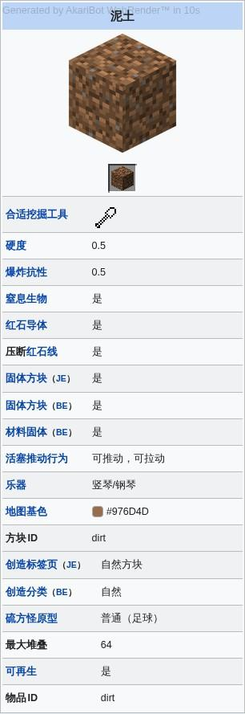
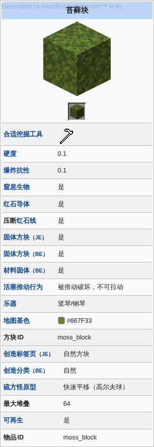
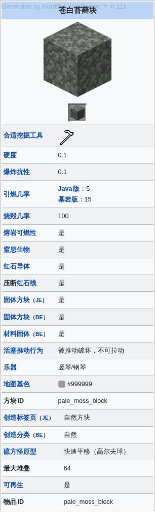
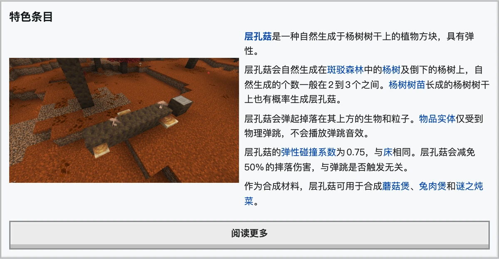

---
hero:
  image: /module-wiki/assets/mediawiki.svg
  alt: MediaWiki 标志
  tagline: 查询 MediaWiki 页面、模板与最近更改。
  fit: contain
  background: "#f8f9fa"
---

# wiki

此模块提供一组操作 MediaWiki 站点的命令。此模块可以查询页面与模板，按照 InterWiki 前缀查询其他站点，并为请求设置自定义请求标头与前缀。

此模块还支持维护 Wiki API 地址的允许列表与阻止列表，管理 Wiki 机器人账号，监控滥用日志与最近更改，并提供中文 Minecraft Wiki 的每周页面与茶馆周报订阅。

`wiki`、`ab`、`rc`、`newbie` 与 `user` 的查询使用当前场景设置的默认 Wiki。`wiki-audit` 与 `wiki-bot` 允许直接指定目标 Wiki 地址。

## wiki

### `wiki`

<CommandUsage :usage="['wiki', 'wiki <pagename> [-l <lang>]']" :params="['pagename=页面标题，可带 InterWiki 前缀', 'lang=语言代码，如 zh、en']" permission="public" :options="[{flag: '-l', desc: '查找该页面的对应语言版本；无结果时返回当前语言。'}]" />

若省略标题，此命令会查询默认 Wiki 的主页。若尚未设置默认 Wiki，此命令将返回配置提示。

填写标题时，此命令查询对应页面。若参数包含模板或解析函数表达式，此命令先将参数作为魔术字求值，再基于求值结果执行查询。

已设置自定义前缀时，此命令会在标题前添加该前缀。若标题包含已配置的 InterWiki 前缀，此命令将查询对应的 Wiki。

若平台支持按钮，页面预览默认采用 button 模式。回复内容包含摘要与链接，并附带“渲染预览图”和“╳”两个按钮。

点击“渲染预览图”后，机器人会发送页面截图。点击“╳”后，机器人会删除该回复以及已发送的截图。

若平台不支持按钮，页面预览自动采用 auto 模式。使用 `wiki style card` 将场景切换为卡片样式后，页面回复将展示为图文卡片，不提供按钮。

<ChatExample
  caption="默认 button 模式。点击「渲染预览图」查看截图，点击「╳」删除回复与截图。"
  :log="[
    '用户：~wiki 泥土',
    '机器人：泥土（Dirt）是一种在主世界中大量生成的软质方块。',
    '`https://zh.minecraft.wiki/w/泥土`',
  ]"
  :buttons="[
    {
      label: '渲染预览图',
      loading: '正在生成预览图',
      reply: ['机器人：{natural}'],
    },
    { label: '╳', dismiss: true },
  ]"
/>

<ChatExample
  caption="省略标题时查询默认 Wiki 的主页。"
  :log="[
    '用户：~wiki',
    '机器人：欢迎来到这个完全公开、可自由编辑的Wiki，中文Minecraft Wiki。这里致力于收集一切和Minecraft系列有关的信息。任何人都可以为Wiki作出贡献！',
    '`https://zh.minecraft.wiki/`',
  ]"
/>

<ChatExample
  caption="尚未设置默认 Wiki 时，查询会提示先设置，并附带推荐 Wiki 按钮。"
  :log="[
    '用户：~wiki 泥土',
    '机器人：没有设置默认 Wiki，使用“~wiki set”设置默认 Wiki。',
    '点击下方按钮，设置推荐的 Wiki。',
  ]"
  :buttons="[
    {
      label: 'Minecraft Wiki',
      reply: ['机器人：成功设置默认 Wiki：Minecraft Wiki (zh)'],
    },
  ]"
/>

### `wiki magic`

<CommandUsage usage="wiki magic <expression> [-p <page>]" :params="['expression=魔术字表达式，可省略花括号', 'page=求值用的页面上下文']" permission="public" :options="[{flag: '-p', desc: '指定魔术字求值时的页面上下文；含空格的标题用引号包裹。'}]" />

此命令用于查询目标 Wiki 注册的魔术字与扩展解析函数，返回短文本或查询链接。表达式支持 `#expr`、字符串处理与站点变量。

若表达式不完整、包含不支持的魔术字、缺少页面上下文或结果过长，此命令将返回对应提示。

<ChatExample
  :log="[
    '用户：~wiki magic #expr:6*7',
    '机器人：42',
  ]"
/>

### `wiki id`

<CommandUsage usage="wiki id <pageid> [-l <lang>]" :params="['pageid=数字页面 ID，可带 InterWiki 前缀', 'lang=语言代码，如 zh、en']" permission="public" :options="[{flag: '-l', desc: '查找该页面的对应语言版本；无结果时返回当前语言。'}]" />

此命令按照页面 ID 查询对应页面。`<pageid>` 可以包含 InterWiki 前缀，移除前缀后必须为纯数字，否则此命令将返回提示。

<ChatExample
  :log="[
    '用户：~wiki id 6054',
    '机器人：苦力怕（Creeper）是常见的敌对生物，它会悄无声息地接近玩家，当距离目标3格以内时就会开始爆炸。',
    '`https://zh.minecraft.wiki/w/苦力怕`',
  ]"
/>

### `wiki random`

<CommandUsage usage="wiki random" permission="public" />

此命令用于随机查询一个条目命名空间页面。

<ChatExample
  :log="[
    '用户：~wiki random',
    '机器人：末影人（Enderman）是一种来自末地、会瞬移的高大黑色敌对生物。',
    '`https://zh.minecraft.wiki/w/末影人`',
  ]"
/>

### `wiki search`

<CommandUsage usage="wiki search <pagename>" :params="['pagename=搜索关键词']" permission="public" />

此命令用于搜索页面，至多返回 5 条结果。回复结果前的编号，或点击按钮，即可查询对应页面。

<ChatExample
  caption="点击编号查询页面。页面回复同样附带预览与删除按钮。"
  :log="[
    '用户：~wiki search 苔藓块',
    '机器人：搜索结果：',
    '点击按钮以查询对应的页面。',
  ]"
  :buttons="[
    {
      label: '1. 苔藓块',
      loading: '正在打开页面',
      reply: [
        '机器人：苔藓块（Moss Block）是一种生成于繁茂洞穴、能在骨粉的作用下快速蔓延的植物方块。',
        '`https://zh.minecraft.wiki/w/苔藓块`',
      ],
      buttons: [
        {
          label: '渲染预览图',
          loading: '正在生成预览图',
          reply: ['机器人：{natural}'],
        },
        { label: '╳', dismiss: true },
      ],
    },
    {
      label: '2. 苍白苔藓块',
      loading: '正在打开页面',
      reply: [
        '机器人：苍白苔藓块（Pale Moss Block）是一种生成于苍白之园生物群系的方块。',
        '`https://zh.minecraft.wiki/w/苍白苔藓块`',
      ],
      buttons: [
        {
          label: '渲染预览图',
          loading: '正在生成预览图',
          reply: ['机器人：{natural}'],
        },
        { label: '╳', dismiss: true },
      ],
    },
  ]"
/>

### `wiki render`

<CommandUsage usage="wiki render <mode>" :params="['mode=渲染方式 button、auto、off']" permission="admin" />

此命令用于切换页面渲染方式。`button` 在回复中附带预览按钮，`auto` 自动补发页面截图，`off` 关闭页面渲染。若取值不属于上述三者，此命令将返回错误提示。

<ChatExample
  caption="button：页面回复只显示摘要、链接和预览按钮。"
  :log="[
    '用户：~wiki render button',
    '机器人：已切换为消息展示按钮。',
    '用户：~wiki 泥土',
    '机器人：泥土（Dirt）是一种在主世界中大量生成的软质方块。',
    '`https://zh.minecraft.wiki/w/泥土`',
  ]"
  :buttons="[
    {
      label: '渲染预览图',
      loading: '正在生成预览图',
      reply: ['机器人：{natural}'],
    },
    { label: '╳', dismiss: true },
  ]"
/>

<ChatExample
  caption="auto：发送摘要与链接后自动补发页面截图，不显示预览按钮。"
  :log="[
    '用户：~wiki render auto',
    '机器人：已切换为自动渲染 Wiki 页面。',
    '用户：~wiki 泥土',
    '机器人：泥土（Dirt）是一种在主世界中大量生成的软质方块。',
    '`https://zh.minecraft.wiki/w/泥土`',
    '{natural}',
  ]"
/>

<ChatExample
  caption="off：仅发送摘要与链接，不渲染页面截图。"
  :log="[
    '用户：~wiki render off',
    '机器人：已关闭 Wiki 页面渲染。',
    '用户：~wiki 泥土',
    '机器人：泥土（Dirt）是一种在主世界中大量生成的软质方块。',
    '`https://zh.minecraft.wiki/w/泥土`',
  ]"
/>

### `wiki style`

<CommandUsage usage="wiki style <mode>" :params="['mode=消息样式 text 或 card']" permission="admin" />

- 此命令用于切换 Wiki 消息样式，默认设置为 `text`，仅在 QQ 群与 QQ 私聊中注册。
- `card` 将页面回复渲染为图文卡片。标题取页面标题，摘要取页面描述，配图取页面代表图的 100 像素缩略图。
- 若页面未设置代表图，卡片将不附带配图。若查询目标包含修订号，或查询内容为差异对比，卡片同样不附带配图。
- 卡片消息不支持按钮，`button` 预览模式因此自动转为 `auto`。

<ChatExample
  caption="切换后页面查询改用卡片消息；卡片消息不支持按钮，button 预览模式改用 auto。"
  :log="[
    '用户：~wiki style card',
    '机器人：已切换为卡片消息样式。卡片消息不支持按钮，button 预览模式将改用 auto（自动渲染）模式。',
  ]"
/>

<ChatExample
  caption="卡片样式：查询「石头」时返回的图文卡片。"
  :log="['用户：~wiki 石头']"
  :card="{
    title: '石头',
    description: '石头（Stone）是在主世界中大量存在的方块。',
    url: 'https://zh.minecraft.wiki/w/石头',
    image: 'wiki-card-stone.png',
    domain: 'zh.minecraft.wiki',
  }"
/>

### `wiki set`

<CommandUsage usage="wiki set <wikiurl>" :params="['wikiurl=页面、站点或 API 地址']" permission="admin" :aliases="['wiki_start_site']" />

此命令用于设置场景的默认 Wiki，参数为页面地址、站点地址或 API 地址。每个场景保存一个默认 Wiki，再次设置会覆盖原有设置。

若地址无法解析，此命令将返回失败详情。若地址包含在全局阻止列表中，此命令将拒绝设置。

`wiki iw` 分组的子命令均可以使用 `interwiki` 替代，例如 `interwiki list`。

<ChatExample
  :log="[
    '用户：~wiki set https://zh.minecraft.wiki',
    '机器人：成功设置默认 Wiki：Minecraft Wiki (zh)',
  ]"
/>

### `wiki iw add`

<CommandUsage usage="wiki iw add <interwiki> <wikiurl>" :params="['interwiki=InterWiki 前缀名', 'wikiurl=站点地址，解析为 API 地址']" permission="admin" :aliases="['wiki iw set']" />

此命令用于添加自定义 InterWiki。`<interwiki>` 为前缀名，`<wikiurl>` 会先解析为 API 地址再保存。若前缀已存在，此命令将覆盖原有设置。若地址无法解析，此命令将返回失败详情。

<ChatExample
  :log="[
    '用户：~wiki iw add wikipedia https://zh.wikipedia.org',
    '机器人：已添加自定义 InterWiki：',
    'wikipedia -> 维基百科 (zh)',
  ]"
/>

### `wiki iw remove`

<CommandUsage usage="wiki iw remove <interwiki>" :params="['interwiki=InterWiki 前缀名']" permission="admin" :aliases="['wiki iw del', 'wiki iw delete']" />

此命令用于删除自定义 InterWiki。若前缀未设置，此命令同样返回成功。

<ChatExample
  :log="[
    '用户：~wiki iw remove wikipedia',
    '机器人：已删除自定义 InterWiki：wikipedia',
  ]"
/>

### `wiki iw list`

<CommandUsage usage="wiki iw list [--legacy]" permission="public" :options="[{flag: '--legacy', desc: '强制使用文本列表。'}]" />

此命令列出当前设置的自定义 InterWiki，结果附带查看默认 Wiki InterWiki 的链接。平台支持图片时，此命令将列表渲染为表格图片。附带 `--legacy` 选项时，此命令改用文本列表展示。若未设置自定义 InterWiki，此命令将返回添加提示。

<ChatExample
  :log="[
    '用户：~wiki iw list --legacy',
    '机器人：当前设置了以下 InterWiki：',
    'wikipedia: https://zh.wikipedia.org/w/api.php',
    '此处展示的是为机器人设置的自定义 InterWiki，如需查看默认 Wiki 的 InterWiki，请见：`https://zh.minecraft.wiki/w/Special:Interwiki`',
  ]"
/>

### `wiki iw get`

<CommandUsage usage="wiki iw get <interwiki>" :params="['interwiki=InterWiki 前缀名']" permission="public" />

此命令用于获取 InterWiki 对应的 API 地址。若前缀未配置，此命令将返回未找到提示。

<ChatExample
  :log="[
    '用户：~wiki iw get wikipedia',
    '机器人：`https://zh.wikipedia.org/w/api.php`',
  ]"
/>

### `wiki headers show`

<CommandUsage usage="wiki headers show" permission="public" />

此命令列出当前场景设置的自定义请求标头，结果以 JSON 对象形式返回。若未设置，此命令将返回空对象。

<ChatExample
  :log="[
    '用户：~wiki headers show',
    '机器人：当前设置了以下请求标头：\n{}\n如需自定义，请使用“~wiki headers add”。\n示例：\n~wiki headers add {&quot;accept-language&quot;: &quot;zh-CN,zh;q=0.9,en;q=0.8,en-GB;q=0.7,en-US;q=0.6&quot;}',
  ]"
/>

### `wiki headers add`

<CommandUsage usage="wiki headers add <headers>" :params="['headers=JSON 对象，标头名与内容']" permission="admin" />

此命令用于添加或覆盖请求标头。`<headers>` 为 JSON 对象，键为标头名，值为写入内容。若参数不属于 JSON 对象，此命令将返回失败提示。

<ChatExample
  :log="[
    '用户：~wiki headers add {&quot;accept-language&quot;:&quot;zh-CN&quot;}',
    '机器人：已更新请求时所使用的请求标头：{&quot;accept-language&quot;:&quot;zh-CN&quot;}',
  ]"
/>

### `wiki headers remove`

<CommandUsage usage="wiki headers remove <headerkey>" :params="['headerkey=要删除的标头名']" permission="admin" />

此命令按照名称删除指定的请求标头。若标头不存在，此命令将返回失败提示。

<ChatExample
  :log="[
    '用户：~wiki headers remove accept-language',
    '机器人：已更新请求时所使用的请求标头：{}',
  ]"
/>

### `wiki headers reset`

<CommandUsage usage="wiki headers reset" permission="admin" />

此命令用于清空当前场景设置的全部自定义请求标头。

<ChatExample
  :log="[
    '用户：~wiki headers reset',
    '机器人：已重置请求时所使用的请求标头。',
  ]"
/>

### `wiki prefix set`

<CommandUsage usage="wiki prefix set <prefix>" :params="['prefix=拼在查询标题前的文本']" permission="admin" />

此命令用于设置查询标题时附加的前缀。设置后，此命令会将此前缀添加至标题前。该前缀用于统一命名空间，或区分同名页面。

<ChatExample
  :log="[
    '用户：~wiki prefix set Help:',
    '机器人：已更新请求时所使用的前缀：Help:',
  ]"
/>

### `wiki prefix reset`

<CommandUsage usage="wiki prefix reset" permission="admin" />

此命令用于清除自定义前缀，恢复直接查询原始标题。

<ChatExample
  :log="[
    '用户：~wiki prefix reset',
    '机器人：已重置请求时所使用的前缀。',
  ]"
/>

### `wiki redlink`

<CommandUsage usage="wiki redlink" permission="admin" />

此命令用于切换页面不存在时是否返回编辑链接。每执行一次，此命令均在启用与停用状态之间切换。

<ChatExample
  :log="[
    '用户：~wiki redlink',
    '机器人：已开启页面不存在时返回编辑链接。',
  ]"
/>

## wiki-inline

<ModuleAlias names="wiki_inline, wiki_regex" />

此模块不包含命令，根据消息内容自动触发。

- `[[标题]]`：查询页面，忽略以 `#` 开头的标题。去除重复标题后，至多处理 5 个页面。
- 使用双层花括号包裹的模板名：解析模板调用与解析函数。
- `≺标题≻` 或 `⧼标题⧽`：查询 MediaWiki 命名空间页面。
- Wiki 页面 URL：生成 Infobox 预览或返回文件，具体形式取决于页面渲染配置。

## wiki-audit

<ModuleAlias names="wiki_audit, wau" />

### `wiki-audit trust`

<CommandUsage usage="wiki-audit trust <wikiurl>" :params="['wikiurl=页面、站点或 API 地址']" permission="superuser" />

此命令从 Wiki 页面、站点或 API 地址中解析出 API 地址，并将其添加至全局 URL 允许列表。若地址无法解析，或已包含在阻止列表中，此命令将返回失败。

<ChatExample
  :log="[
    '用户：~wiki-audit trust https://zh.minecraft.wiki',
    '机器人：已将规则加入用户自定义 URL 允许列表：https://zh.minecraft.wiki/api.php',
  ]"
/>

### `wiki-audit block`

<CommandUsage usage="wiki-audit block <wikiurl>" :params="['wikiurl=页面、站点或 API 地址']" permission="superuser" />

此命令从 Wiki 页面、站点或 API 地址中解析出 API 地址，并将其添加至全局 URL 阻止列表。若地址无法解析，此命令将返回失败。

<ChatExample
  :log="[
    '用户：~wiki-audit block https://zh.wikipedia.org',
    '机器人：已将规则加入用户自定义 URL 阻止列表：https://zh.wikipedia.org/w/api.php',
  ]"
/>

### `wiki-audit distrust`

<CommandUsage usage="wiki-audit distrust <wikiurl>" :params="['wikiurl=页面、站点或 API 地址']" permission="superuser" />

此命令从全局 URL 用户允许列表中移除指定的 API 地址。若地址未包含在列表中，此命令将返回未找到提示。

<ChatExample
  :log="[
    '用户：~wiki-audit distrust https://zh.minecraft.wiki',
    '机器人：已从用户自定义 URL 允许列表删除规则：https://zh.minecraft.wiki/api.php',
  ]"
/>

### `wiki-audit unblock`

<CommandUsage usage="wiki-audit unblock <wikiurl>" :params="['wikiurl=页面、站点或 API 地址']" permission="superuser" />

此命令从全局 URL 用户阻止列表中移除指定的 API 地址。若地址未包含在列表中，此命令将返回未找到提示。

<ChatExample
  :log="[
    '用户：~wiki-audit unblock https://zh.wikipedia.org',
    '机器人：已从用户自定义 URL 阻止列表删除规则：https://zh.wikipedia.org/w/api.php',
  ]"
/>

### `wiki-audit query`

<CommandUsage usage="wiki-audit query <wikiurl>" :params="['wikiurl=页面、站点或 API 地址']" permission="superuser" />

此命令解析 API 地址并查询匹配的全局允许列表规则，返回规则来源。若未命中规则，此命令将返回未授权结论。

<ChatExample
  :log="[
    '用户：~wiki-audit query https://zh.minecraft.wiki',
    '机器人：https://zh.minecraft.wiki/api.php 已被以下全局规则放行：',
    '[用户规则] https://zh.minecraft.wiki/api.php',
  ]"
/>

## wiki-bot

<ModuleAlias names="wiki_bot, wbot" />

### `wiki-bot login`

<CommandUsage usage="wiki-bot login <apilink> <account> <password>" :params="['apilink=页面、站点或 API 地址', 'account=机器人账号用户名', 'password=账号密码']" permission="superuser" />

此命令用于登录 Wiki 机器人账号并保存。若账号已存在，此命令提示先登出。若登录失败，此命令将返回失败原因。

### `wiki-bot logout`

<CommandUsage usage="wiki-bot logout <apilink>" :params="['apilink=页面、站点或 API 地址']" permission="superuser" />

此命令用于删除已保存的 Wiki 机器人账号。

### `wiki-bot toggle`

<CommandUsage usage="wiki-bot toggle" permission="superuser" />

此命令用于切换当前场景是否使用机器人账号，返回启用或停用的结果。

<ChatExample
  :log="[
    '用户：~wiki-bot toggle',
    '机器人：已开启使用机器人账户。',
  ]"
/>

## ab、rc、newbie、user

### `ab`

<CommandUsage usage="ab [--legacy]" permission="public" :options="[{flag: '--legacy', desc: '强制使用文本模式。'}]" />

此命令获取默认 Wiki 的最近滥用日志。QQ 平台具备合并转发或渲染能力时，此命令优先返回合并转发消息或渲染结果，否则返回普通消息。若获取失败或日志受到查看权限限制，此命令将返回错误提示。

<ChatExample
  :log="[
    '用户：~ab --legacy',
    '机器人：`https://zh.minecraft.wiki/w/Special:AbuseLog`\n•2026-11-12 21:03:11 - Example 在 草方块 执行操作“edit”时触发了过滤器。\n过滤器描述：破坏性编辑\n采取的行动：warn',
  ]"
/>

### `rc`

<CommandUsage usage="rc [--legacy]" permission="public" :options="[{flag: '--legacy', desc: '强制使用文本模式。'}]" />

此命令获取默认 Wiki 的最近更改。QQ 平台具备合并转发或渲染能力时，此命令优先返回合并转发消息或渲染结果，否则返回普通消息。若获取失败或日志受到查看权限限制，此命令将返回错误提示。

<ChatExample
  :log="[
    '用户：~rc --legacy',
    '机器人：`https://zh.minecraft.wiki/w/Special:RecentChanges`\n•2026-11-12 21:02:45 - 草方块 .. (+128) .. Example\n（修正笔误）',
  ]"
/>

### `newbie`

<CommandUsage usage="newbie" permission="public" />

此命令获取默认 Wiki 的新用户日志。

<ChatExample
  :log="[
    '用户：~newbie',
    '机器人：`https://zh.minecraft.wiki/w/Special:Log?type=newusers`\nExampleUser\nSteve\nAlex',
  ]"
/>

### `user`

<CommandUsage usage="user <username>" :params="['username=用户名，可带 InterWiki 前缀']" permission="public" />

此命令用于查询 MediaWiki 用户信息。`username` 可以包含 InterWiki 前缀。前缀必须为已配置的 InterWiki，否则此命令将按照原名查询。

<ChatExample
  :log="[
    '用户：~user Example',
    '机器人：用户：Example | 编辑数：0\n用户组：*、user\n性别：未知\n注册时间：2026 年 07 月 04 日 00:48:20 (UTC+8)',
  ]"
/>

## wikilog

### `wikilog add wiki`

<CommandUsage usage="wikilog add wiki <apilink>" :params="['apilink=页面、站点或 API 地址']" permission="superuser" />

此命令用于将指定的 Wiki 添加至监控列表。若地址无法解析，此命令将返回失败原因。若该 Wiki 已包含在列表中，此命令将返回操作失败。

<ChatExample
  :log="[
    '用户：~wikilog add wiki https://zh.minecraft.wiki',
    '机器人：成功操作 Wiki：Minecraft Wiki (zh)',
  ]"
/>

### `wikilog reset wiki`

<CommandUsage usage="wikilog reset wiki <apilink>" :params="['apilink=页面、站点或 API 地址']" permission="superuser" />

此命令将该 Wiki 的监控配置恢复为默认值。

<ChatExample
  :log="[
    '用户：~wikilog reset wiki https://zh.minecraft.wiki',
    '机器人：成功操作 Wiki：Minecraft Wiki (zh)',
  ]"
/>

### `wikilog remove wiki`

<CommandUsage usage="wikilog remove wiki <apilink>" :params="['apilink=页面、站点或 API 地址']" permission="superuser" />

此命令从监控列表移除指定的 Wiki。若地址未包含在列表中，此命令将返回操作失败。

<ChatExample
  :log="[
    '用户：~wikilog remove wiki https://zh.minecraft.wiki',
    '机器人：成功操作 Wiki：Minecraft Wiki (zh)',
  ]"
/>

### `wikilog enable`

<CommandUsage usage="wikilog enable <apilink> <logtype>" :params="['apilink=页面、站点或 API 地址', 'logtype=日志类型，ab、rc 或全名']" permission="superuser" />

此命令用于启用一种类型的日志监控，`logtype` 可以选取 `ab`、`rc` 或对应全名。若取值无效或 Wiki 未加入监控列表，此命令将返回失败提示。

<ChatExample
  :log="[
    '用户：~wikilog enable https://zh.minecraft.wiki ab',
    '机器人：成功操作了 Minecraft Wiki (zh) AbuseLog 的监控设置。',
  ]"
/>

### `wikilog disable`

<CommandUsage usage="wikilog disable <apilink> <logtype>" :params="['apilink=页面、站点或 API 地址', 'logtype=日志类型，ab、rc 或全名']" permission="superuser" />

此命令用于禁用一种类型的日志监控。

<ChatExample
  :log="[
    '用户：~wikilog disable https://zh.minecraft.wiki ab',
    '机器人：成功操作了 Minecraft Wiki (zh) AbuseLog 的监控设置。',
  ]"
/>

### `wikilog filter set`

<CommandUsage usage="wikilog filter set <apilink> <logtype> ..." :params="['apilink=页面、站点或 API 地址', 'logtype=日志类型，ab、rc 或全名']" permission="superuser" />

此命令为某一类型的日志设置条件过滤器，`...` 处填写多条正则表达式。若未指定条件，此命令将提示条件为空。

<ChatExample
  :log="[
    '用户：~wikilog filter set https://zh.minecraft.wiki ab 破坏',
    '机器人：成功为 Minecraft Wiki (zh) AbuseLog 设置了以下过滤器：',
    '破坏',
  ]"
/>

### `wikilog filter reset`

<CommandUsage usage="wikilog filter reset <apilink> <logtype>" :params="['apilink=页面、站点或 API 地址', 'logtype=日志类型，ab、rc 或全名']" permission="superuser" />

此命令用于重置某一类型日志的条件过滤器。

<ChatExample
  :log="[
    '用户：~wikilog filter reset https://zh.minecraft.wiki ab',
    '机器人：成功为 Minecraft Wiki (zh) AbuseLog 设置了以下过滤器：',
    '*',
  ]"
/>

### `wikilog filter test`

<CommandUsage usage="wikilog filter test <filters> <example>" :params="['filters=匹配样本的正则表达式', 'example=用于匹配的样例文本']" permission="superuser" />

此命令用于测试条件过滤器能否匹配给定样例，返回匹配位置。若表达式存在错误，此命令将提示匹配失败。

<ChatExample
  :log="[
    '用户：~wikilog filter test ^bot bot_test',
    '机器人：成功在 0, 3 处匹配了文本：bot',
  ]"
/>

### `wikilog filter example`

<CommandUsage usage="wikilog filter example <example>" :params="['example=待转换的 JSON 数据']" permission="superuser" />

此命令将数据转换为条件过滤器能够识别的样例。若样例不属于有效 JSON，此命令将提示格式无效。

<ChatExample
  :log="[
    '用户：~wikilog filter example {&quot;user&quot;:&quot;Example&quot;}',
    '机器人：user=Example',
  ]"
/>

### `wikilog api get`

<CommandUsage usage="wikilog api get <apilink> <logtype>" :params="['apilink=页面、站点或 API 地址', 'logtype=日志类型，ab、rc 或全名']" permission="superuser" />

此命令获取指定 Wiki 上对应日志类型的 API 数据链接。

<ChatExample
  :log="[
    '用户：~wikilog api get https://zh.minecraft.wiki ab',
    '机器人：`https://zh.minecraft.wiki/api.php?action=query&list=abuselog&aflprop=user%7Ctitle%7Caction%7Cresult%7Cfilter%7Ctimestamp&afllimit=30`',
  ]"
/>

### `wikilog rcshow set`

<CommandUsage usage="wikilog rcshow set <apilink> ..." :params="['apilink=页面、站点或 API 地址']" permission="superuser" />

此命令为最近更改日志设置筛选条件，取值参见下文列表。若条件无效，此命令将返回提示。

<ChatExample
  :log="[
    '用户：~wikilog rcshow set https://zh.minecraft.wiki !bot !minor',
    '机器人：成功为 Minecraft Wiki (zh) 最近更改监控设置了以下筛选条件：',
    '!bot',
    '!minor',
  ]"
/>

### `wikilog rcshow reset`

<CommandUsage usage="wikilog rcshow reset <apilink>" :params="['apilink=页面、站点或 API 地址']" permission="superuser" />

此命令用于重置最近更改日志设置的筛选条件。

<ChatExample
  :log="[
    '用户：~wikilog rcshow reset https://zh.minecraft.wiki',
    '机器人：成功为 Minecraft Wiki (zh) 最近更改监控设置了以下筛选条件：',
  ]"
/>

### `wikilog bot enable`

<CommandUsage usage="wikilog bot enable <apilink>" :params="['apilink=页面、站点或 API 地址']" permission="superuser" />

此命令用于启用机器人获取日志。

<ChatExample
  :log="[
    '用户：~wikilog bot enable https://zh.minecraft.wiki',
    '机器人：成功操作 Wiki：Minecraft Wiki (zh)',
  ]"
/>

### `wikilog bot disable`

<CommandUsage usage="wikilog bot disable <apilink>" :params="['apilink=页面、站点或 API 地址']" permission="superuser" />

此命令用于禁用机器人获取日志。

<ChatExample
  :log="[
    '用户：~wikilog bot disable https://zh.minecraft.wiki',
    '机器人：成功操作 Wiki：Minecraft Wiki (zh)',
  ]"
/>

### `wikilog keepalive enable`

<CommandUsage usage="wikilog keepalive enable <apilink>" :params="['apilink=页面、站点或 API 地址']" permission="superuser" />

此命令用于启用机器人登录状态检查。

<ChatExample
  :log="[
    '用户：~wikilog keepalive enable https://zh.minecraft.wiki',
    '机器人：成功操作 Wiki：Minecraft Wiki (zh)',
  ]"
/>

### `wikilog keepalive disable`

<CommandUsage usage="wikilog keepalive disable <apilink>" :params="['apilink=页面、站点或 API 地址']" permission="superuser" />

此命令用于禁用机器人登录状态检查。

<ChatExample
  :log="[
    '用户：~wikilog keepalive disable https://zh.minecraft.wiki',
    '机器人：成功操作 Wiki：Minecraft Wiki (zh)',
  ]"
/>

### `wikilog note set`

<CommandUsage usage="wikilog note set <apilink> ..." :params="['apilink=页面、站点或 API 地址']" permission="superuser" />

此命令用于设置指定 Wiki 的备注，监控消息将使用该备注代替 Wiki 名称。若 Wiki 未加入监控列表，此命令将返回失败。

<ChatExample
  :log="[
    '用户：~wikilog note set https://zh.minecraft.wiki 主站',
    '机器人：成功为 Minecraft Wiki (zh) 设置了备注：主站',
  ]"
/>

### `wikilog note remove`

<CommandUsage usage="wikilog note remove <apilink>" :params="['apilink=页面、站点或 API 地址']" permission="superuser" />

此命令用于移除指定 Wiki 的备注。

<ChatExample
  :log="[
    '用户：~wikilog note remove https://zh.minecraft.wiki',
    '机器人：成功为 Minecraft Wiki (zh) 设置了备注：',
  ]"
/>

### `wikilog list`

<CommandUsage usage="wikilog list" permission="superuser" />

此命令列出各个 Wiki 的监控配置。

上述各命令的 `logtype` 参数可以选取 `ab`、`rc`、`abuselog`、`recentchanges`、`AbuseLog` 与 `RecentChanges`。最近更改的筛选条件可以取 `!anon`、`!autopatrolled`、`!bot`、`!minor`、`!patrolled`、`!redirect`、`anon`、`autopatrolled`、`bot`、`minor`、`patrolled`、`redirect` 与 `unpatrolled`。

<ChatExample
  :log="[
    '用户：~wikilog list',
    '机器人：https://zh.minecraft.wiki/api.php: \n滥用过滤器日志：已启用\n条件过滤器：\n&quot;破坏&quot;\n最近更改：已启用\n条件过滤器：\n&quot;!bot&quot;\n筛选条件：\n&quot;!bot&quot; &quot;!minor&quot;\n使用机器人获取信息：已禁用\n备注：主站',
  ]"
/>

## weekly

### `weekly`

<CommandUsage usage="weekly" permission="public" />

此命令获取中文 Minecraft Wiki 的每周页面，QQ 平台会附带图片。

<ChatExample
  :log="[
    '用户：~weekly',
    '机器人：本周页面：苔藓块（Moss Block）是一种生成于繁茂洞穴、能在骨粉的作用下快速蔓延的植物方块。……\n图片：`https://zh.minecraft.wiki/images/Moss_Block_JE1_BE1.png`\n页面链接：`https://zh.minecraft.wiki/w/苔藓块`\n每周页面：`https://zh.minecraft.wiki/w/Minecraft_Wiki:特色条目/Minecraft/2026#第46周`',
  ]"
/>

### `weekly image`

<CommandUsage usage="weekly image" permission="public" />

此命令获取每周页面的截图版本。

<ChatExample
  :log="[
    '用户：~weekly image',
    '机器人：',
  ]"
/>

### `weekly teahouse`

<CommandUsage usage="weekly teahouse" permission="public" />

此命令获取茶馆周报。

<ChatExample
  :log="[
    '用户：~weekly teahouse',
    '机器人：茶馆周报第 46 期\n\n……',
  ]"
/>

### `weekly teahouse image`

<CommandUsage usage="weekly teahouse image" permission="public" />

此命令获取茶馆周报的截图版本。

## RSS

`weekly-rss` 与 `teahouse-weekly-rss` 不提供命令，仅提供 RSS 订阅。前者在每周一 9:00 推送中文 Minecraft Wiki 的每周页面，后者在每周一 9:30 推送茶馆周报。推送同时提供简体中文与繁体中文文本，QQ 平台使用图片版本。

### 每周页面订阅

<ChatExample
  caption="示例内容随当周页面变化"
  :log="[
    '用户：~module enable weekly-rss',
    '机器人：成功：开启模块“weekly-rss”。',
    '〰〰〰',
    '机器人：如需获取每周页面的文字版本及链接，请使用“~weekly”。',
    '本周页面：苔藓块（Moss Block）是一种生成于繁茂洞穴、能在骨粉的作用下快速蔓延的植物方块。……',
    '图片：`https://zh.minecraft.wiki/images/Moss_Block_JE1_BE1.png`',
    '页面链接：`https://zh.minecraft.wiki/w/苔藓块`',
    '每周页面：`https://zh.minecraft.wiki/w/Minecraft_Wiki:特色条目/Minecraft/2026#第46周`',
  ]"
/>

QQ 平台发送整条消息的图片，其他平台发送文字与链接。

### 茶馆周报订阅

<ChatExample
  caption="示例内容随当周推送变化"
  :log="[
    '用户：~module enable teahouse-weekly-rss',
    '机器人：成功：开启模块“teahouse-weekly-rss”。',
    '〰〰〰',
    '机器人：如需获取每周页面的文字版本及链接，请使用“~weekly teahouse”。',
    '茶馆周报 26w46a',
    '茶馆周报更新了如下内容：',
    '  * 上周的Minecraft新闻',
    '    * Java版快照26.4-snapshot-7',
    '    * 基岩版测试版26.70.23',
    '  * ……',
  ]"
/>
