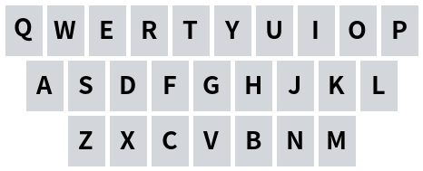
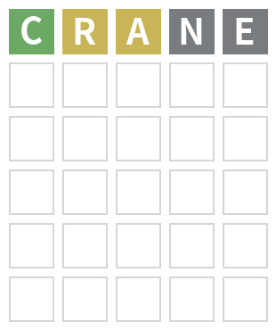
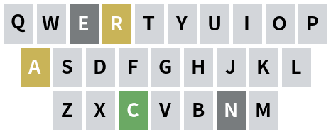
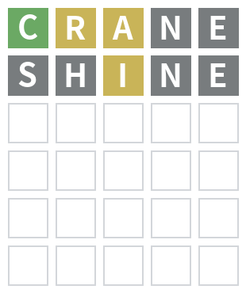
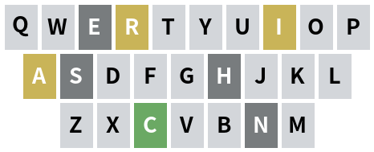
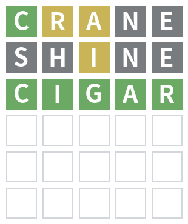
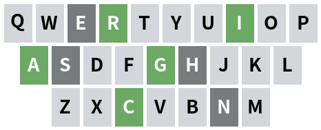

# wordle

猜一个五个字母的英文单词，最多六次机会。每次提交后按字母与位置给出绿、黄、灰三色反馈。

## 命令

### `wordle`

<CommandUsage usage="wordle [--hard] [--trial]" permission="public" :options="[{flag: '--hard', desc: '使用困难模式。'}, {flag: '--trial', desc: '使用挑战模式。'}]" />

开始新游戏，最多六次机会。`--hard` 与 `--trial` 分别开启困难模式与挑战模式，两者可同时使用。

<ChatExample
  caption="答案 cigar，三次猜中；图片为实际渲染结果。"
  :image-width="320"
  :log="[
    '用户：~wordle',
    '机器人：',
    '',
    '游戏开始，你需要猜一个由 5 个字母组成的单词，你有 6 次机会。',
    '绿色表示字母和位置都正确，黄色代表字母正确但位置不正确，灰色代表单词中没有这个字母。',
    '用户：crane',
    '机器人：',
    '',
    '用户：shine',
    '机器人：',
    '',
    '用户：cigar',
    '机器人：',
    '',
    '祝贺！你在 3 回合内完成了游戏。',
  ]"
/>

### `wordle stop`

<CommandUsage usage="wordle stop" permission="public" />

结束当前对局并公布答案，同时附上剑桥词典链接；没有进行中的对局时返回停止失败提示。

<ChatExample
  :log="[
    '用户：~wordle stop',
    '机器人：已停止，答案为：cigar。',
    '查询词典：',
  ]"
/>

## 游戏规则

- 答案从内置词表中随机抽取，猜词必须存在于可提交词表中。
- 绿色表示字母与位置均正确，黄色表示字母正确但位置错误，灰色表示该字母在当前尝试中已无剩余匹配。
- 困难模式要求后续提交保留上一回合的绿色字母位置，并满足黄色字母的出现次数。
- 默认等待会话内任意成员提交，挑战模式只接受发起者本人的下一条消息。
- 超过六次仍未猜中时公布答案并附上剑桥词典链接。
- 挑战模式猜中后奖励花瓣：三次以内猜中奖励 2 枚，否则奖励 1 枚；同一局同时开启困难模式时额外奖励 1 枚。
- 非超级用户两次开局间隔不少于 180 秒，对局结束或执行 `stop` 后重置冷却。
- 对局状态按会话隔离，1 小时后过期；机器人服务重启后对局中断。
